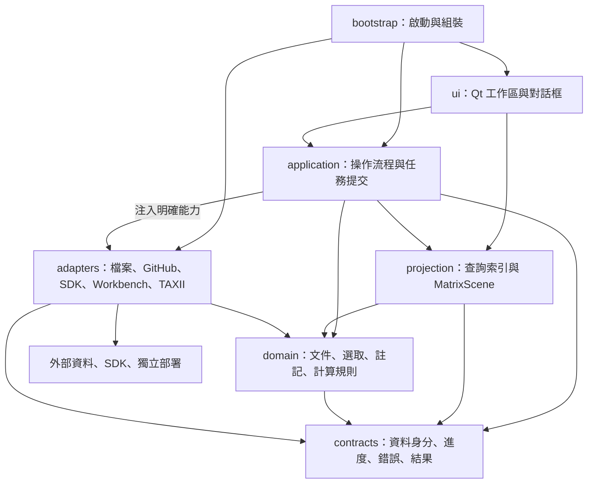
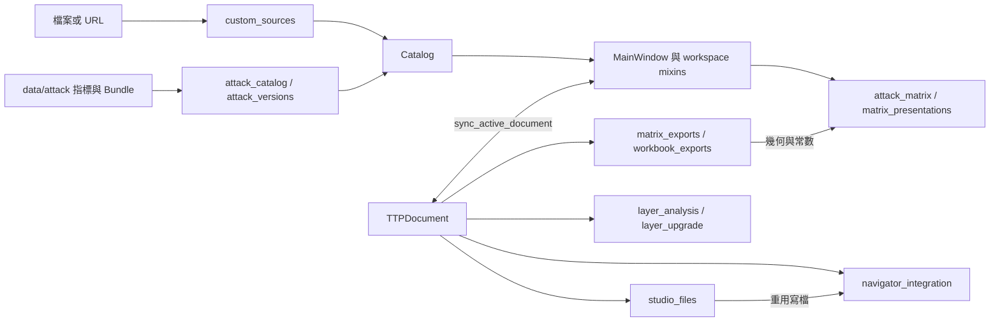
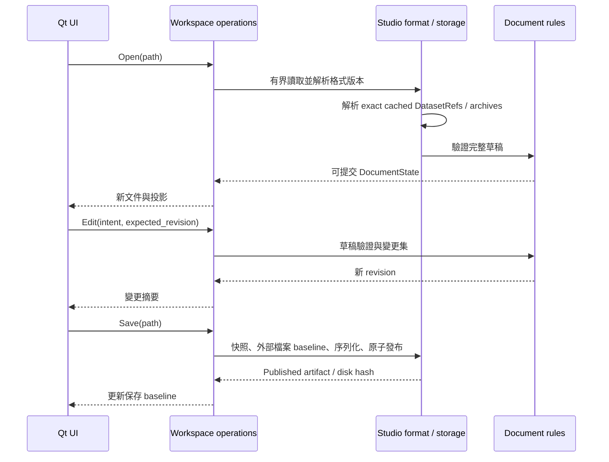
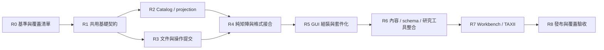

# Fusion Studio 整體架構規劃

文件版本：1.0（架構提案，尚未實作）  
盤點日期：2026-10-16（Asia/Taipei）  
適用工作目錄：`D:\MITREATTACK_SIMULATOR`  
配套證據：[MITRE 官方 repositories 完整盤點](MITRE_REPOSITORY_INVENTORY.md)

## 1. 文件目的與已確認目標

本專案的長期目標是：**盡可能整合 `mitre-attack` 官方 GitHub 組織內各公開 repository 所提供的能力，形成一致的 ATT&CK 研究與工作平台，並容納使用者稍後提出的構想。**

本文件取代先前對「只做 TTP 勾選與匯出」的長期範圍假設。現有的 [NOTIMPLEMENTYET.md](NOTIMPLEMENTYET.md) 仍是目前功能缺口紀錄，其中「不屬於目前產品範圍」不能直接當成永久排除條件。使用者尚未說明的構想，不在本文件中自行補成已確認需求。

這次交付僅新增架構文件、上游研究文件與 README 導覽；不變更 Python 程式、依賴、資料格式、資料快取、使用者文件或執行行為。本文件中所有目標套件路徑、Interface、資料模型、重構階段與驗收條件，除明確標示「現況」之外，均為待實作提案。

「整合所有 repo」採**能力覆蓋**定義：

1. 逐 repo 登錄其公開用途，拆出可被使用者操作、匯入、查詢或交換的能力。
2. 按實際用途採用 Python SDK、資料匯入、格式交換、遠端連接、可選獨立程序或原生功能實作；不預設每個 repo 都要複製成桌面畫面。
3. 部署範本、文件、舊版範例與已封存工具也要有處理結果；可列為部署支援、相容性樣本或歷史參考，不能用一個「已整合」勾選掩蓋用途差異。
4. 每項能力記錄支援版本、相容性限制、驗證證據與授權來源；有明確對映且通過驗收才算完成。
5. 新增或轉移的官方 repo 需重新盤點。此次組織清單與 commit 證據以配套盤點文件為準，不承諾跨時間永遠固定數量。

## 2. 證據、現況與限制

### 2.1 盤點方法

- 讀取當前工作樹的 Python 原始碼、README、待辦、依賴清單與 LICENSE；不僅依 Git 已提交內容判斷功能。
- 靜態解析 Python imports 與公開函式／類別；未 import 應用程式、啟動 GUI、下載資料或執行既有 audit。
- 本次盤點根目錄有 32 個非 audit Python 檔；初始讀取時有 20 個 `audit_*.py`，交付校對時因工作樹新增 `audit_matrix_display.py` 成為 21 個；`scripts/` 另有 2 個程式。數量為本次讀取快照，非永久架構限制。
- 官方 repo 的用途、狀態與來源由 [上游盤點](MITRE_REPOSITORY_INVENTORY.md) 支持。架構建議與官方已實作功能分開表述。
- 工作樹原先已有大量未提交變更；後續實作不能假設可以整批還原或覆寫。
- 文件編寫期間另偵測到 `attack_matrix.py`、`custom_sources.py`、`audit_layer_analysis.py` 的內容變動，以及新增的 `audit_matrix_display.py`；本次未寫入這些程式。已補讀相關來源與新增 audit，核心責任對映仍適用。這是工作樹讀取快照，並非單一已提交 commit 的完整可重現執行驗證；後續 R0 必須重新固定基準。

### 2.2 現有能力

| 領域 | 已有基礎 | 主要程式證據 |
| --- | --- | --- |
| 資料與版本 | 官方快照、SHA-256／大小檢查、歷史版本、離線讀取、Enterprise／Mobile／ICS、自訂 Bundle／Collection Index | [attack_catalog.py](attack_catalog.py)、[attack_versions.py](attack_versions.py)、[custom_sources.py](custom_sources.py) |
| 文件生命週期 | 多文件、UUID、Studio Open／Save／Save As、dirty baseline、外部修改偵測、關閉提示、checkpoint／復原 | [ttp_documents.py](ttp_documents.py)、[studio_files.py](studio_files.py)、[studio_workspace.py](studio_workspace.py) |
| 選取與搜尋 | 技術／戰術 occurrence 選取、家族聯動、跨戰術偏好、多欄位搜尋、來源物件批次加入／移除 | [ttp_selection.py](ttp_selection.py)、[ttp_search.py](ttp_search.py)、[selection_workspace.py](selection_workspace.py) |
| Navigator | Layer JSON、全域／戰術註記、Links／Metadata、顏色／分數／enabled、Side／Flat／Mini、overlay、公式與聚合 | [navigator_integration.py](navigator_integration.py)、[navigator_visuals.py](navigator_visuals.py)、[attack_matrix.py](attack_matrix.py)、[layer_analysis.py](layer_analysis.py) |
| 比較與遷移 | 官方 SDK DiffStix、選取比較、逐項審閱遷移、原始文件與歷史封存保留 | [navigator_integration.py](navigator_integration.py)、[layer_upgrade.py](layer_upgrade.py) |
| 輸出 | Studio JSON、CSV、Navigator JSON、矩陣 SVG／XLSX、全分頁 workbook | [matrix_exports.py](matrix_exports.py)、[svg_export.py](svg_export.py)、[workbook_exports.py](workbook_exports.py) |
| 操作介面與說明 | PySide6 桌面工作區、資料庫側欄、Procedure Examples、原生對話框、進度、雙語手冊 | [main.py](main.py)、[manual/README.md](manual/README.md) |

直接依賴檔宣告 `PySide6==6.12.0`、`mitreattack-python==6.2.1`、`openpyxl==3.1.5`；完整釘選清單見 [requirements-lock.txt](requirements-lock.txt)。這是檔案宣告，並不代表本次重新驗證了所有執行環境與套件相容性。

### 2.3 現有架構問題

| 觀察 | 影響 | 處理優先度 |
| --- | --- | --- |
| `MainWindow` 同時管理畫面、文件、選取同步、版本、批次操作與匯出；`StudioWorkspace`／`SelectionWorkspace` 透過共享 `self` 使用隱含欄位 | 新能力容易要求修改同一主視窗，無法從類別宣告看出完整 Interface | 高 |
| `MainWindow.selected` 與 `TTPDocument.selected` 需要同步 | 畫面／文件可能有短暫不同來源；Undo、背景提交與多分頁更難定義 | 高 |
| `studio_files.py` 使用 `navigator_integration.write_json_atomic`，快照複製位於 `layer_analysis.py` | Studio 保存與復原對 Navigator／公式模組形成不必要依賴 | 高 |
| `matrix_exports.py`、`workbook_exports.py` 從 Qt 的 `attack_matrix.py` 匯入 `matrix_columns`／常數 | 匯出投影必須載入 GUI 模組，妨礙 headless 使用與測試 | 高 |
| `navigator_fields` → `navigator_integration` → `navigator_fields` 存在含函式內匯入的靜態循環 | 目前延遲匯入不等於程式故障，但模組責任尚未收斂 | 中高 |
| `TTPDocument` 將 Navigator raw dict、業務狀態、封存與檔案 baseline 放在一起；多處直接修改 dict | 新格式、來源與狀態規則可能洩漏到 UI／計算流程 | 中高 |
| 官方／自訂 catalog 各有建構流程；搜尋索引動態掛在 catalog 上 | 新資料來源容易重做索引、驗證與快取規則；共享物件的可變狀態需明確化 | 中 |
| progress callback 同時承擔文字、百分比與協作取消；worker 位於 Navigator 對話框檔內 | 其他整合功能需要依賴 Navigator UI 才能使用通用背景工作 | 中 |

上述是維護風險，不是本次宣告已重現的使用者故障。架構重構不能以「消除 import」為由改變既有選取與保存語意。

## 3. 設計原則與整體型態

### 3.1 主體採模組化桌面單體

保留 PySide6 作為主要桌面入口。文件、catalog、選取、公式與匯出投影在同一 Python 程序內運作。Workbench 後端、TAXII、網站建置與 TypeScript 工具依需要透過獨立 Adapter 使用，不強制成為桌面啟動依賴。

現階段不導入全域訊息匯流排、分散式資料庫或任意程式插件平台。先用明確的函式／物件 Interface 與結果事件；只有存在可替換 Implementation 或已確認的相容性需求時才增加 Seam。

### 3.2 Module／Interface／Seam／Adapter

- **Module（模組）**：具有對外 Interface 與內部 Implementation 的責任單位；不等於每一檔案都要獨立包裝。
- **Interface（介面契約）**：包含輸入輸出、呼叫順序、資料不變條件、錯誤、取消與版本支援，不只函式參數。
- **Seam（替換接點）**：確有多種資料來源或交換方式的位置，例如官方 GitHub／本機 Bundle、Studio／Navigator 格式。
- **Adapter（接合實作）**：在 Seam 上處理 SDK、網路、格式或程序細節；不允許把上游物件與例外散佈到所有呼叫端。

模組應把複雜規則藏在小而完整的 Interface 後面。既有純函式可直接保留；不為每個函式增加只轉呼叫的類別。

### 3.3 不變條件

1. 每份文件綁定明確資料集、release、domain；同一版本字串不代表內容相同。
2. 選取、enabled、畫面可見性與註記是不同狀態。取消選取不自動刪除註記，隱藏不等於未選取。
3. 技術層級與 tactic occurrence 層級都必須保留；不得將 partial selection 默默擴大到所有戰術。
4. 官方原始資料不被使用者編輯覆寫；擴充資料與衍生分析獨立保存。
5. 保存成功與交換匯出是不同結果；CSV／SVG／XLSX 不代表完整文件已保存。
6. 取消、驗證失敗或寫檔失敗不留下半套文件、半套復原結果或被截斷的舊輸出。
7. 背景結果只可提交到它開始時的文件／revision；資料集已更換時必須拒絕 stale result。
8. 所有處理開始前顯示輸入／輸出絕對路徑；無檔案操作則明確顯示記憶體輸入與無檔案輸出。每階段都報告進度與完成／失敗／取消。

## 4. 目標模組與依賴方向

下圖箭頭表示「呼叫／依賴」，不是資料存放位置：



`application` 可使用組裝時注入的 Adapter 能力，不能從具體 `adapters/workbench`／Qt 檔案直接 import。上圖的 Adapter 箭頭是執行時呼叫；靜態 import 以契約為接點。`domain`、`projection` 與 `contracts` 不依賴 Qt、網路、Workbook 寫入器或上游 SDK。

### 4.1 模組責任表

| Module | 負責 | 不負責 | 主要輸入／輸出 |
| --- | --- | --- | --- |
| `contracts` | DatasetRef、ObjectRef、ProgressEvent、OperationResult、能力狀態與錯誤型別 | 文件編輯、UI、網路 | 穩定且可序列化的契約 |
| `domain/catalog` | 原始物件視圖、domain 投影、關聯與身分規則 | 下載／讀檔／畫面 | 驗證後的原始資料 → CatalogSnapshot |
| `domain/document` | DocumentState、註記規則、封存、選取、revision、內容指紋 | 路徑對話框、SDK 格式、寫檔 | 文件草稿／命令 → 新狀態／變更摘要 |
| `domain/analysis` | 公式、比較、聚合與遷移決策；保留既有缺值與作用範圍規則 | 任意腳本執行、直接改原文件 | 來源快照 → 新文件或報告 |
| `projection` | 搜尋、關聯查詢、樹與矩陣投影、色彩、排序、顯示文字 | QWidget、檔案發布 | Catalog＋Document＋ViewSpec → 查詢／MatrixScene |
| `application/datasets` | discover／prepare／validate／publish 的流程與快取身分 | 把資料來源細節暴露給 UI | 來源選擇 → 已驗證 DatasetRef |
| `application/workspace` | 開關文件、命令提交、active document、dirty/save baseline、checkpoint | 儲存 Qt widget、操作上游物件 dict | 使用者操作 → WorkspaceSnapshot／事件 |
| `application/operations` | 背景任務生命週期、取消、revision 核對與錯誤轉換 | 在 worker thread 變更 QWidget | OperationRequest → OperationResult |
| `application/integrations` | 能力清單、連接狀態、拉取／推送預覽與套用 | 假裝所有 repo 共用同一資料語意 | IntegrationSpec → 結果／待處理差異 |
| `adapters/storage` | 有界讀取、原子發布、鎖、檔案 baseline、cache／session 檔案 | 決定選取與註記語意 | bytes／envelope ↔ 檔案 |
| `adapters/formats` | Studio／Navigator／CSV／SVG／XLSX 格式、版本轉換、欄位保留 | UI 選取、覆寫來源資料 | canonical state／scene ↔ 格式資料 |
| `adapters/upstream` | 官方 GitHub、Python SDK、ADM、CAR、Workbench、TAXII 等各別接合 | 跨功能直接修改文件 | 上游資料／回應 ↔ 本地契約 |
| `ui` | 主視窗、分頁、樹、矩陣、表單、進度呈現、操作意圖 | 文件真實狀態、交易、網路重試 | ViewModel → 畫面；Intent → application |
| `bootstrap` | 路徑、設定、版本與 Adapter 組裝、Qt 啟動、Windows 整合 | 業務規則 | 啟動參數 → 可使用工作區 |

### 4.2 擬議目錄

```text
D:\MITREATTACK_SIMULATOR\
  main.py                         # 後期保留為啟動相容入口
  ARCHITECTURE.md
  MITRE_REPOSITORY_INVENTORY.md
  README.md
  studio/
    README.md
    bootstrap.py
    contracts/
    domain/                       # catalog、document、selection、analysis
    projection/                   # search、relationships、matrix scene、appearance
    application/                  # datasets、workspace、operations、integrations
    adapters/
      storage/
      formats/
      upstream/
    ui/                           # windows、dialogs、models、workers
  tests/                          # 後期漸進移入；保留原 audit 入口相容性
  scripts/
  manual/
  assets/
  data/                           # 目前位置先相容保留
  artifacts/
```

這是目標，不是第一步搬檔清單。先在現有路徑建立真實 Interface，再逐模組遷移。每個新增程式所在目錄必須有 README.md，記錄流程、路徑、執行方式、進度與失敗處理；目錄不存在前不先建立空殼。

## 5. 核心資料模型與所有權

### 5.1 資料身分

| 模型 | 必要內容 | 規則 |
| --- | --- | --- |
| `DatasetRef` | source kind、repository／endpoint、release、commit（可用時）、domain bundle hashes、manifest schema、取得時間 | 官方來源也應有內容身分；現況官方 `dataset_id` 為空字串，不可直接沿用成唯一長期身分 |
| `CatalogSnapshot` | DatasetRef、原始物件／關聯、active 與 historical views | 已發布快照唯讀；索引可重建，不改官方物件 |
| `ObjectRef` | dataset identity、domain、STIX ID、modified／object version（可用時） | STIX ID 與 ATT&CK ID 分開；同 ID 跨來源或 domain 不能無條件覆寫 |
| `TechniqueOccurrence` | ObjectRef＋tactic slug | partial selection、註記、計算與匯出都使用同一 occurrence 語意 |
| `DocumentState` | UUID、名稱、DatasetRef、選取、全域／戰術註記、持久顯示設定、來源擴充、封存、revision | 唯一業務狀態來源，由 workspace 擁有，UI 只取投影 |
| `DocumentHandle` | save path、disk baseline hash、saved content token、最後交換輸出 | 路徑與磁碟狀態不混入業務計算；Save As 更新 Handle |
| `WorkspaceState` | 文件順序、active UUID、文件 Handles、checkpoint 狀態 | 不保存 QWidget，也不把 tab index 當永久文件識別 |
| `ViewState` | 目前頁面、搜尋文字、scroll、overlay 開關、臨時選單狀態 | 暫態畫面設定不因重畫而標記文件 dirty；哪些設定持久化需逐項明列 |
| `DerivedArtifact` | 類型、來源 ObjectRefs、演算法／版本、參數、產生時間與結果 | CAR 對映、推導關聯、差異報告等不假裝是官方原始事實 |
| `CapabilityRecord` | repo、能力、upstream ref、支援範圍、整合方式、狀態、證據 | 支援宣告以能力為單位，不以 repo 名稱自動視為全功能完成 |

`ObjectRef` 的 domain 是來源語境，不是宣稱某物件只能屬於一個 domain。跨 domain 合併視圖可有多來源引用，但每份原始紀錄仍可回溯。

### 5.2 選取與註記

現有 `selected: set[STIX_ID]`＋`selection_scopes` 是壓縮格式。第一輪重構保留磁碟表示與既有規則，先以 `TechniqueOccurrence` 的集合操作封裝，避免 UI 自行增刪兩份狀態。

全域註記與戰術註記分層解析；「沒有 scoped 欄位」與「明確設為 false／0／空字串」不可混淆。未知 Navigator 擴充、重複 raw rows 與原始精度先保留在格式 Adapter 的 raw envelope；業務讀取使用明確的 effective-value 規則。Canonical normalization 尚未證明可無損時，不能刪除 raw envelope。

### 5.3 修改交易與 Undo

統一修改流程：`取得文件 revision → 建立草稿 → 驗證全部規則 → 一次提交 → revision 遞增 → 發出變更摘要 → UI 更新／排程 checkpoint`。失敗不更新來源文件。

Undo／Redo 先涵蓋文件內可逆操作，例如選取、註記、批次編輯與顯示設定；用變更集或受容量限制的快照保存。外部檔案發布、下載與 Workbench 推送不屬於一般 Undo。版本／資料集遷移建立新文件並保留舊文件，另存遷移決策，不依賴 Undo 才能找回來源。

### 5.4 Catalog 與快取

- 目前 `snapshot_document` 共享 catalog，深拷貝文件的可變欄位；在 catalog 被證明唯讀前，不能稱整張物件圖已深度不可變。
- 未來把搜尋與關聯索引移到 `IndexCache`，以完整 dataset hash＋domain＋index schema／algorithm version 作 key。
- 快取損壞應可刪除後從已驗證的原始資料重建；使用者註記不可只存在快取。
- 先使用版本目錄與記憶體索引；只有量測顯示啟動／記憶體不符合目標時才增加可重建 SQLite 索引，避免過早引入雙重真相。

## 6. 現況資料流與目標資料流

### 6.1 現況



這張圖只摘要現有依賴，不宣稱列出所有 imports。

### 6.2 啟動、資料載入與版本切換

1. `bootstrap` 解析啟動參數、目前資料根目錄、設定與 session 路徑，先顯示所有已知絕對輸入／輸出。
2. Dataset 流程解析 manifest，檢查路徑、大小與 hash；沒有網路需求時保持離線。
3. 資料來源 Adapter 讀 bytes；Catalog 建構流程驗證、保留 raw objects、產生三個 domain views 與來源／程序／偵測索引。
4. 所有必要資料成功後，才發布 CatalogSnapshot；Qt 執行緒分批建立畫面投影。
5. 使用者選擇版本時先準備目標快照；記憶體預覽／正式套用／active pointer 寫入是分開步驟。失敗保留原工作區與既有 pointer。
6. 單純切換快照不得被標成完整註記遷移；跨版本保留與移除規則要有差異摘要，正式遷移使用第 6.6 節。

### 6.3 開啟、編輯與保存文件



Open／Recovery 不依嵌入 URL 自動下載。缺少相符 Bundle 時提供缺件清單，由明確資料準備操作取得後再重試。保存 baseline 只在檔案發布成功且來源 revision 仍符合時更新；外部檔案改動時不自動覆寫。

### 6.4 搜尋、矩陣與匯出

`CatalogSnapshot＋DocumentSnapshot＋ViewSpec → 同一 projection → MatrixScene → Qt renderer／SVG renderer／XLSX renderer`。

- `MatrixScene` 必須是純資料：tactics、families、cells、effective notes／score／color、選取與 enabled、來源引用及必要幾何。
- Side／Flat／Mini 是 renderer／projection 選項，不改文件選取規則。
- 搜尋、平台篩選、排序、aggregate、overlay 與 sub-technique 展開範圍由明確 `ViewSpec` 控制。
- 畫面匯出可以選擇沿用目前 ViewSpec；全分頁 workbook 依每份文件的保存設定，不偷用 active tab 的臨時搜尋。
- SVG Preview 在記憶體產生；寫入器先完整驗證再產生 sibling temporary file，最後一次發布。
- Workbook 任一 layer 失敗則整檔不發布；不得默默少一張工作表。
- 數值、Unicode、CSV quoting、Excel 公式字串、sheet 命名與 SVG escaping 維持既有驗證行為。

### 6.5 checkpoint、復原與關閉

1. 文件提交成功後 debounce；建立帶 revision 的 workspace 快照，worker 只處理快照。
2. session 寫入與 Studio Save 使用不同路徑及語意；session lock 維持單一擁有者。
3. 若排程期間又有編輯，舊 checkpoint 完成後仍須排下一版；舊結果不將新狀態誤判為已保存。
4. 復原先驗證所有文件、資料集與歷史封存，再一次安裝；單項失敗保留原 session 與原工作區。
5. 關閉採 Save／Discard／Cancel；任一 Save 失敗或 Cancel 保留應保留的分頁。
6. Discard 要使被丟棄草稿不會在下次復原出現；寫入失敗不能假裝已丟棄成功。
7. 這些是已存在的生命週期語意；重構必須先用現有 audit 固定，再替換 Implementation。

### 6.6 比較與遷移

`兩份已驗證 Snapshot → Diff Adapter → 統一 DifferenceReport → MigrationPreview → 使用者逐項／批次決策 → 完整驗證 → 新 DocumentState＋來源封存＋決策歷程`。

DiffStix 的分類與本地遷移 mapping 是不同責任。`revoked-by` 可提供建議，不能推論所有變更都有一對一替代；合併衝突、已移除 tactic、未知項目必須出現在預覽。既有批次註記規則、partial selection 與 custom dataset identity 必須保留。官方與自訂來源的切換也不能只靠相同 ATT&CK ID 自動套用。

### 6.7 Workbench／TAXII 同步

初次只做明確的唯讀拉取：`連線設定 → 發現可用能力 → 選 collection／範圍 → 分頁拉取 → 完整快照驗證 → diff preview → 安裝成獨立資料集或知識擴充`。

之後才開放有明確目標的 Workbench 寫入：以 base object revision／modified、目標 collection 與本地變更產生預覽，再推送及讀回核對。衝突保留本地草稿與遠端版本，不自動採最後寫入者勝出。TAXII 的拉取、發布與 Workbench CRUD 分開設能力；端點未支援的操作不能在 UI 假裝可用。網路失敗與 timeout 不改本地已提交文件。

## 7. 官方 repositories 的能力整合架構

完整清單、active／archived／fork 狀態、逐 repo commit 與來源見 [MITRE_REPOSITORY_INVENTORY.md](MITRE_REPOSITORY_INVENTORY.md)。本節定義整合方式，不取代逐 repo 實作驗收。

### 7.1 能力群組

| 能力群組 | 代表上游 | 接入方式 | 桌面呈現與範圍 |
| --- | --- | --- | --- |
| 權威資料與網站內容 | `attack-stix-data`、`attack-website` | 官方版本化資料優先；網站內容／模板另作參考與連結 | catalog、引用、說明；不為讀資料執行整個網站建置系統 |
| SDK 與 schema | `mitreattack-python`、`attack-data-model` | Python SDK 接合；ADM 是 TypeScript／Zod，採可選 Node Adapter 或經驗證的格式契約 | 查詢、diff、格式與 schema 診斷；上游 schema version 與 ATT&CK release 分開管理 |
| 矩陣與 layer | `attack-navigator` | 既有原生功能與 layer 格式互通，逐項建立能力對照；必要時才評估可選 web view | 顏色、註記、公式、比較、輸出；不宣稱 bounded formula 等同任意 mathjs |
| 可編輯知識庫 | Workbench frontend／REST／TAXII／deployment repos | 連接既有部署；需要隨附時採可選獨立部署 profile | 物件與關聯編輯、筆記、collections、發布／訂閱；以實際上游能力為準 |
| 偵測與分析內容 | `car`、資料來源相關 repo | 匯入可解析內容與引用，建立 technique 對映；保留原始格式與版本 | 偵測研究、sensor／log requirement 與資料來源導覽；不自動執行 analytics |
| 評估、映射與研究工具 | 評估／mapping／coverage 類 repo | 逐項評估資料格式、授權與方法，輸出來源可追溯的 DerivedArtifact | 專門報告／工作流程；不同分數不可無條件合成「防禦率」 |
| 舊工具、文件與部署 | archived、舊 scripts、範例、部署範本 | 歷史格式 fixtures、可替換的受控工具、文件入口／部署說明 | 保留可追溯用途；不將封存腳本直接變成預設執行鏈 |

Workbench 是獨立後端系統，不應複製一份 MongoDB 資料模型塞進 `TTPDocument`。本地文件可引用知識庫物件，但 source identity、remote revision、草稿修改及同步狀態需分開。[Workbench 官方說明](https://github.com/mitre-attack/attack-workbench-frontend)

ADM 的執行環境與 Python 不同；是否採 Node sidecar 必須由實際 schema 能力缺口決定。其 stdout 僅輸出有版本的 JSON 結果，stderr／進度另行處理；逾時、退出碼、輸出上限及工具版本均由 Adapter 管理。[ADM 官方說明](https://github.com/mitre-attack/attack-data-model)

### 7.2 整合完成的判定

每個 `CapabilityRecord` 至少有：

| 欄位 | 說明 |
| --- | --- |
| `repo`／`upstream_ref` | 完整 owner/name、release 或 commit，避免只記 master |
| `capability_id`／描述 | 使用者可理解的能力，例如 layer JSON round trip，不只 repo 名稱 |
| `mode` | native／library／data／remote／optional-process／reference |
| `support_state` | inventoried、planned、partial、verified、reference-only、blocked；不得把 planned 顯示成 verified |
| `supported_inputs` | domain、release、schema／protocol、格式與限制 |
| `owner_module` | 誰負責此能力與錯誤處理 |
| `license_evidence` | 對應內容與程式的授權檔來源、NOTICE、再散布策略；GitHub metadata 不等於最終判定 |
| `verification` | fixture、contract checks、UI／CLI 驗收與最後驗證時間 |
| `gaps` | 已知未支援範圍、fallback、棄用與替代計畫 |

同一能力可能來自多個 repo；例如 Navigator JSON 可由原生程式與 Python SDK 共同完成，不能重複計算成功率。網站、後端、部署屬不同層次，也不以檔案匯入代替完整功能支援。

### 7.3 上游版本與更新流程

`重新列出組織 repos → 比較新增／封存／搬移 → 比較已釘選 ref → 讀 changelog／schema → 隔離 fixture 驗證 → 更新 capability support matrix → 使用者可辨識的支援版本發布`。

開發依賴、資料版本與 protocol version 分別釘選。不能因為 pip 升級成功，就自動更新所有 catalog 或重寫既有文件。Beta／實驗資料以不同 source kind 顯示，不覆寫 stable；fork 保留來源 lineage。官方組織外的相關項目另列補充，不能混入這次 21 個公開 repo 的完成分母。

### 7.4 全部 21 個 repo 的初始責任與階段對映

下表是目前程式靜態盤點與上游研究的交叉結果。「已有部分」只表示能在程式找到對應功能，不代表本次跑過相容測試，亦不代表已完整覆蓋該 repo。

| Repo | 本案責任／整合產物 | 現況與缺口 | 對應階段 |
| --- | --- | --- | --- |
| `attack-stix-data` | datasets、GitHub Adapter、版本化 snapshots | 已有下載／三域／歷史；需統一官方與 custom identity、builder 與 schema 診斷 | R2、R6 |
| `mitreattack-python` | SDK Adapter、DiffReport、格式驗證與轉換 | 已有 SDK layer probe／DiffStix；其餘查詢／collections／Excel 能力逐項核對 | R4、R6 |
| `attack-data-model` | schema diagnostics、可選 Node Adapter | 尚無 ADM 執行接合；先驗證 spec／release 支援，不能直接當 Python 套件 | R6 |
| `attack-navigator` | layers、matrix、analysis、formats | 已有多數核心原生流程；bounded expressions、context menu、自訂來源與格式細節需能力對照 | R4、R6 |
| `attack-workbench-frontend` | knowledge workspace、物件／關聯／筆記工作流程 | 尚無 Workbench 知識編輯／協作接合；可先深連結與遠端物件檢視 | R7 |
| `attack-workbench-rest-api` | Workbench Adapter、RemoteObjectDraft、SyncPlan | 尚無 authenticated CRUD／collections 同步；需版本與衝突契約 | R7 |
| `attack-workbench-taxii-server` | TAXII ingestion／share Adapter | 現有 Collection Index 不等於 TAXII；需 discovery、分頁與實際版本追溯 | R7 |
| `attack-workbench-deployment` | 可選部署 profile 與健康／版本檢查 | 尚無部署接合；避免綁定桌面預設啟動 | R7、R8 |
| `attack-website` | 引用、知識說明投影、可選靜態研究頁輸出 | 已有官方連結／原文；網站生成與客製呈現尚非現有功能 | R6 |
| `car` | DetectionCatalog、analytic／tool／sensor 對映 | 目前 Detections 是 STIX 物件瀏覽，不等於匯入 CAR | R6 |
| `bzar` | Zeek 偵測內容與 notice artifact Adapter | 尚無 BZAR／Zeek log 匯入；外部執行依環境能力後議 | R6、可選 R7 |
| `caret` | 跨 catalog 的關聯投影／圖形工作區 | 已有若干清單與 procedure 導覽；尚無 CARET 式多種物件關聯視圖 | R6 |
| `attack-arsenal` | 對手模擬資源／計畫 metadata 與來源目錄 | 尚無上游資源匯入；先保存計畫與可用 artifact，不自動執行 | R6、可選 R7 |
| `attack-scripts` | 舊格式 fixtures、script 能力遷往 SDK 對照 | 不引入封存 runtime；檢查遺漏能力並採現行 SDK／本地實作 | R0、R4、R6 |
| `attack-datasources` | 歷史來源模型／映射檔相容與引用 | 目前可搜尋部分 legacy 欄位；未等同完整 repo 內容覆蓋 | R2、R6 |
| `attack-datasources-stix-beta` | 明標 mock 的 schema／關聯 fixtures | 研究／測試參考；不得混入正式資料、正式 coverage 或預設下載 | R0、R6 |
| `tram` | ReportMappingJob、候選 TTP、人工審閱 | 舊 repo 為後繼來源線索；新能力需另外驗證模型／語言／涵蓋範圍 | R6 |
| `joystick` | EvaluationCatalog、結果查詢與比較視圖 | 尚無評估結果匯入；保持輪次與方法論身分，不直接做通用排行 | R6 |
| `attack-evals` | 歷史評估來源與現行渠道銜接 | 檔案再利用授權與後繼資料取得方式待核實；可先顯示來源入口 | R6、R8 |
| `evals_caldera` | EmulationPlan、可選 Runner Adapter 與 RunArtifact | 先研究歷史計畫／後繼 Emu；執行能力需獨立範圍與環境驗收 | R6、可選 R7 |
| `attack-archives` | 歷史引用／舊頁相容、現行版本流程對照 | 不建立新的日常同步依賴；作來源與歷史相容參考 | R0、R6 |

### 7.5 新能力的專用資料流

為避免「所有內容都塞入 TTPDocument」，以下模型在能力落地時才新增；本次不預先建立空 class 或套件。

| 工作流程 | 新增的責任與資料 | 提交到文件的方式 |
| --- | --- | --- |
| 知識編輯／Workbench | `KnowledgeDraft` 保存基準 ObjectRef、欄位修改、關聯與 remote revision；官方快照不改動，個人筆記與正式知識草稿分開 | 審閱後生成自訂 collection／本地擴充，或明確推送到遠端；文件只引用其 DatasetRef |
| CAR／BZAR 偵測研究 | `DetectionCatalog` 保存 analytic ID、query 原文、tool／sensor 條件、版本與 TTP mappings；`RunArtifact` 可記錄使用者提供的 Zeek notices／其他結果 | 以引用／證據加入文件；規則存在、部署、已收集資料與實測有效分成不同狀態 |
| CARET 式關聯視圖 | 由 ATT&CK、CAR、sensor 等來源建立可重建的 `RelationshipProjection`；每條 edge 保留來源、direct／derived 與適用版本 | 選取 edge／物件後產生明確編輯意圖；畫面連線不自動變成官方事實或選取 |
| TRAM 報告映射 | `ReportSource → MappingJob → MappingCandidates`；保存原文片段、模型／版本、候選 technique、可用置信資訊及人工決策 | 接受候選才將 TTP／引用加入選定文件；拒絕／修改歷程可追溯，不自動全部勾選 |
| Joystick／Evaluations | `EvaluationDataset` 保存輪次、供應商、場景、步驟、判定分類、方法論版本與原始來源 | 分析結果為獨立報告／layer；不同輪次或方法不相容時禁止產生無條件合併總分 |
| Arsenal／Emu／Caldera | `EmulationPlan`、`RunRequest`、`RunArtifact` 分離；計畫匯入不建立執行權限；可選外部 Runner 提供 submit／status／cancel／artifact 契約 | 執行結果以 DerivedArtifact 引用；執行不由文件 Open／import 觸發，也不改官方技術紀錄 |
| 網站／歷史資料 | `ReferenceCatalog` 保存官方頁、歷史版與模板來源；可選靜態報告生成使用已授權內容與明確模板版本 | 保留引用與輸出 artifact，不把 HTML scraping 作主要 STIX 資料來源 |

可選 Runner 是容納該類官方 repo 能力的架構位置，並不代表使用者已要求本次實作或執行對手模擬。其目標環境、權限、啟停、取消與 artifact 回收要在獨立能力規格中確認；桌面核心不承擔任意遠端指令介面。

## 8. 對外 Interface 與錯誤契約

以下是契約草案，不是現在已有的類別／函式；實作時可用少量函式，不必每列都建立 class。

| 操作 | 輸入 | 輸出 | 成功提交點與限制 |
| --- | --- | --- | --- |
| `prepare_dataset` | SourceSpec、版本選擇、OperationContext | DatasetRef＋Snapshot＋診斷 | 所有必要檔驗證後才發布；部分下載不成為 active |
| `query_catalog` | Snapshot、QuerySpec | QueryResult／ObjectRefs | 純讀取；分清直接與衍生關聯 |
| `apply_document_edit` | UUID、expected revision、EditIntent | ChangeSet＋新 revision | 所有規則通過後一次替換；UI 不再直接改 dict |
| `open_document` | 絕對路徑、CatalogResolver | 完整 DocumentDraft | 全部 archives 相容才安裝 |
| `save_document` | DocumentSnapshot、Target、DiskBaseline | PublishedArtifact＋新 baseline | 原子檔案發布；來源 revision 過期不得清 dirty |
| `export_document` | Snapshot、FormatSpec、Target | Artifact＋LossReport | 明列不被該格式保存的欄位；不等同完整 Save |
| `build_matrix_scene` | Snapshot、ViewSpec、同身分 overlay sources | MatrixScene | 無 Qt／檔案 I/O；來源不改動 |
| `preview_migration` | 來源文件、目標 Snapshot | MigrationPlan | 記錄來源 revision 與雙方 dataset identity |
| `commit_migration` | Plan、決策、expected revision | 新文件＋AuditTrail | 無未解衝突才提交；保留來源 |
| `sync_collection` | ConnectionSpec、方向、base refs、預覽決策 | SyncResult／Conflicts | 拉取與推送明確分開；不自動覆寫衝突 |

錯誤分類至少包含 Validation、UnsupportedVersion、MissingDataset、IntegrityMismatch、ExternalFileConflict、RemoteConflict、NetworkFailure、Cancelled、StaleResult、DependencyUnavailable。顯示可操作的原因與保留狀態；上游 traceback 可留在診斷，不能成為唯一使用者訊息。

## 9. 背景工作、進度與發布一致性

### 9.1 任務模型

`OperationContext` 包含 operation ID、document UUID／expected revision、輸入／輸出位置、取消訊號與進度回報器。背景工作傳入唯讀 snapshot，不接收 QWidget 或可直接修改的主視窗。

狀態：`queued → running → validating → ready-to-commit → committing → completed`；另有 `cancel-requested → cancelled` 或 `failed`。不是每個任務都有檔案 commit，但結果發布也要有唯一提交點。

- Qt worker 只做資料運算／I/O；Qt model 與 widget 更新回到 UI thread。
- 每文件同一時間只提交一個變更；獨立只讀分析可並行，但返回時必須核對 revision。
- 快照建構、SDK 呼叫與逐列 render 都要有成本可見的階段。無可靠總量時用 indeterminate，不製造百分比。
- 協作取消在 checkpoints 生效。無法中斷的 SDK 階段需顯示等待；獨立程序可設 timeout，不能強殺正在發布檔案的 worker。
- 外部同步重試只處理已知可安全重試的操作；遇到未知提交結果先讀回核對。

### 9.2 進度格式

ProgressEvent 至少含 operation ID、stage key、message、current、total（可未知）、status、timestamp，及已解析的輸入／最終輸出／暫存檔絕對路徑。路徑在處理該檔案前出現；後續才發現的路徑也要在讀寫前補報。

同一事件投影到 terminal、Output、status bar／dialog；核心模組只報資料，不依賴 Qt。日誌不輸出 credentials；遠端 URL 的敏感 query 須遮罩。記憶體操作明列 `Input files: None`、`Output files: None`，不能省略階段回報。

### 9.3 原子保存的限度

現有 temporary＋replace 可避免多數半檔情況，不等於斷電耐久性保證，也不完全消除外部程序在 baseline 檢查與 replace 之間修改檔案的競爭。重構先保持既有保護，再依單寫者鎖／平台能力補強。文件中應精確區分「原子可見性」、「多程序衝突保護」與「耐久性」。

## 10. 格式、持久化與資料遷移

### 10.1 格式分工

| 格式 | 權威用途 | 不保證保存的內容 |
| --- | --- | --- |
| Studio JSON | 完整本地文件、註記、archives、偏好、來源與遷移資訊 | 不把外部 Bundle 一律嵌入；精確資料集需另可取得 |
| Session JSON | workspace checkpoint、分頁順序／草稿／路徑與 baseline | 最後 checkpoint 之後的編輯；不是 intentional Save |
| Navigator JSON | 當前 layer 的標準欄位與可保留擴充 | 跨版本／domain archives、所有 Studio 工作區狀態 |
| CSV | 表格交換與 selected occurrence 摘要 | 完整畫面、非選取註記與整份歷史 |
| SVG／XLSX | 明確 ViewSpec 下的呈現與報表 | 可完整復原的編輯狀態 |
| STIX Collection／Bundle | 官方或使用者知識物件與關聯交換 | Studio 專有的個人選取與畫面狀態，除非另有明確擴充規格 |

### 10.2 相容策略

1. 第一輪保留現有 Studio／session `1.0` 與既有 additive fields；以 golden fixtures 固定解讀方式。
2. 新 schema 與舊 schema reader 分開。需要破壞性變更才升 major，增加 feature flags／extension manifest 時需定義未知欄位保存規則。
3. 資料遷移先建立草稿與差異／loss report；另存新檔。不得在 Open 時自動重寫舊檔。
4. 新 reader 對未知必要功能停止並解釋；可選的未知擴充採有界 opaque envelope 保留。保留不等於允許執行。
5. 舊版程式不理解的新資料不能被宣稱可無損另存；需要格式能力檢查與明確訊息。
6. Save conflict baseline、content token 與 document revision 目的不同；schema migration 需測試三者的對應，不能只改 hash 演算法。

### 10.3 路徑策略

現有 `data/attack`、`data/workspace-session.json`、自訂 hash cache 與 `artifacts` 先保持相容。未來可攜版使用指定目錄，安裝版使用明確使用者資料目錄；以 Paths Module 解析，不直接以工作目錄或 `__file__` 在各模組拼接。

搬移時先驗證來源、目的地與容量，產生計畫，再複製／驗證／切換；保留舊資料可回復。cache 清理只刪未被開啟文件、archives 或 checkpoint 引用的資料；不能因「不是 active version」就刪除。

## 11. 當前檔案到目標模組的遷移表

| 現有檔案 | 目標責任 | 遷移注意事項 |
| --- | --- | --- |
| `main.py` | `bootstrap`＋`ui/workspace`＋application orchestration | 先抽明確操作，最後才縮成入口；保留啟動參數與 audit 入口 |
| `attack_catalog.py` | `domain/catalog`＋`application/datasets`＋storage reader | 先分離純建構與讀檔，保留歷史 tactic 規則與 raw records |
| `attack_versions.py` | datasets 流程＋GitHub／storage Adapter | pointer、快取、commit pinning、取消與完整性不能分散 |
| `custom_sources.py` | GitHub／URL／file reader＋catalog builder＋cache | 整合共同 builder；custom SHA 身分、相對 URL 與有界輸入保留 |
| `ttp_documents.py` | `domain/document`＋Studio／CSV formats | 不先修改檔案 schema；拆除保存路徑與序列化耦合 |
| `ttp_selection.py` | `domain/document/selection` | 維持 family／tactic 作用域與壓縮規則 |
| `ttp_search.py` | `projection/search`＋IndexCache | cache key 完整化；移除動態 catalog 寫入 |
| `ttp_operations.py` | document edits／batch operations | 使用同一提交入口，保留原子批次與 unknown fields |
| `navigator_integration.py` | Navigator format、SDK Adapter、分析流程、storage | 先抽通用 writer／validators，後拆 diff 與操作；不失去 raw precision |
| `navigator_fields.py` | annotation validators＋matrix presentation edits | field validation 不反向依賴格式 exporter；消除延遲匯入循環 |
| `navigator_visuals.py` | `projection/appearance` | raw／effective color、alpha、aggregates、overlay 規則共用 |
| `navigator_field_editor.py` | `ui/dialogs/fields` | 只收集草稿／呈現錯誤 |
| `layer_analysis.py` | document snapshot＋domain analysis | snapshot 先從公式檔分離，避免所有保存流程依賴計算 |
| `score_expression.py` | `domain/analysis/expression` | 保留既有有界 parser；不為完整 mathjs 等價引入任意執行 |
| `layer_upgrade.py` | `domain/analysis/migration` | preview、衝突驗證與提交分開；保留來源與決策 |
| `studio_files.py` | Studio／session format＋storage＋open/save operations | 整份文件驗證後才安裝，writer 不再來自 Navigator |
| `studio_workspace.py` | workspace operations＋薄 Qt presenter | 以 composition 取代共享 `self` mixin；生命週期先固定 |
| `selection_workspace.py` | document edits＋薄 Qt selection presenter | 使用 workspace 真實狀態，不另保留選取權威副本 |
| `attack_matrix.py` | `ui/matrix`＋`projection/matrix` | 純 columns／scope／geometry 先移出 Qt，保持 cell 行為 |
| `matrix_presentations.py` | `ui/matrix/renderers` | Side／Flat／Mini 從共同 scene／state 讀取 |
| `matrix_display.py` | `projection/labels` | 目前已偏純資料，可維持小模組 |
| `matrix_exports.py` | `projection/matrix`＋SVG／XLSX Adapter | 匯出完全不 import Qt 畫面模組 |
| `svg_export.py` | SVG renderer／options validator | 與同 scene 幾何一致；有界設定與 escaping 保留 |
| `workbook_exports.py` | XLSX Adapter＋export operation | 混合 domains／versions 的每分頁獨立投影與整檔發布 |
| `navigator_dialogs.py` | 各 Qt dialogs＋通用 Qt worker | 先抽 worker，再拆功能；不把 SDK 放進 UI 驗證 |
| `studio_dialogs.py`、`source_dialogs.py`、`version_dialog.py` | 對應 Qt dialogs | 明確 task result、cancel、stale preview 與 parent 依賴 |
| `batch_dialogs.py`、`layer_analysis_dialogs.py`、`export_dialogs.py` | 輸入草稿與預覽 UI | 所有正式變更改走 application；不讓 dialog 修改真實 dict |
| `windows_taskbar.py` | `ui/platform/windows` | 平台細節不進 domain；維持可用時啟用 |
| `scripts/download_attack_data.py` | CLI datasets Adapter | 漸進共用下載／驗證邏輯，但保留獨立命令與階段輸出 |
| `scripts/build_windows_icon.py` | build tooling | 不納入執行時業務依賴 |
| `audit_*.py` | contract／integration／Qt regression | 漸進集中共用 fixtures；不先批量搬動或刪除 |

## 12. 分階段重構與擴充順序

階段順序以依賴為主，不給未經實測的工期。R0–R5 以保行為重構為主；R6 起擴充上游整合。使用者構想可在任何階段補入需求評估，但不能繞過文件完整性與提交規則。



### R0：固定基準與官方能力清單

- **範圍**：記錄工作樹快照、依賴與環境；將 repo inventory 拆成 capability matrix；分類目前是 native、partial 或 missing。
- **不改**：畫面、schema、依賴版本與資料快取位置。
- **驗收**：交付校對時 21 支 audit 的執行條件、資料前置、輸出路徑與非零退出規則有清單；實際執行結果分別記錄，缺資料不能算 PASS。現有三域／歷史／custom fixtures 可重現；執行前若又新增 audit，須同步更新基準。
- **回退**：無業務變更；保存基準後才能進 R1。

### R1：抽出通用契約、儲存與任務基礎

- **依賴**：R0。
- **範圍**：先移出 atomic writer、bounded reader、snapshot_document、路徑解析與錯誤／progress 契約；再抽出不屬於 Navigator 的 worker／operation lifecycle。
- **具體順序**：先改內部呼叫共用 writer → 保存 round trip → snapshot utility → worker adapter；避免一次更換所有讀寫與並行模型。
- **驗收**：Studio／session／Navigator 原輸出語意保持；failed write／cancel 不覆寫舊檔；終端與 UI 仍逐階段顯示絕對路徑。`studio_files` 不再透過 Navigator 取得一般寫檔；`studio_workspace` 不再為 snapshot 依賴 formula module。
- **主要回歸**：`audit_studio_lifecycle.py`、`audit_documents.py`、`audit_navigator.py`、`audit_export_options.py`。
- **回退**：保留原函式相容入口一個遷移週期；只轉向已驗證的共用 Implementation，不製造第二份長期邏輯。

### R2：Catalog 建構、來源與純查詢分離

- **依賴**：R1。
- **範圍**：共用 official／custom catalog builder；建立 DatasetRef／ObjectRef；分開 active／historical views；抽出 search／relationship IndexCache；將 matrix columns／scope 查詢移出 Qt。
- **驗收**：Enterprise／Mobile／ICS、早期無 tactic objects、revoked／deprecated、custom 同版本不同 hash 均隔離；跨 domain 同 STIX ID 不覆寫來源；查詢與 scene 準備不 import PySide6。
- **主要回歸**：`audit_catalog.py`、`audit_domains.py`、`audit_related_ttps.py`、`audit_selection_search.py`、`audit_advanced_navigator.py`。
- **回退**：舊 Catalog facade 委派新 builder；先維持既有資料結構讀取，索引可丟棄重建。

### R3：文件狀態與操作提交收斂

- **依賴**：R1；完整資料身分依 R2，未完成前先用相容 identity adapter。
- **範圍**：分離 DocumentState／Handle／ViewState；建立 revision 與單一提交點；將 UI 選取副本改成投影；批次、註記、domain/version 切換經同一流程；在此基礎上加 Undo／Redo。
- **驗收**：partial selection、enabled、註記、dirty 各自獨立；同文件所有畫面一致；過期 worker 結果拒絕提交；Save／Discard／Cancel、復原與外部檔案衝突無回歸。Undo／Redo 的範圍與容量明列。
- **主要回歸**：`audit_documents.py`、`audit_comments.py`、`audit_batch_operations.py`、`audit_selection_search.py`、`audit_studio_lifecycle.py`、`audit_layers.py`。
- **回退**：每次只將一種操作改走新 Interface；未移入的操作仍透過相容入口，不同時修改全部 UI handlers。

### R4：Navigator、分析與匯出投影分離

- **依賴**：R2＋R3。
- **範圍**：統一 MatrixScene；拆 Navigator codec／SDK Adapter／Diff／Migration；把 field validators 移到單向依賴位置；以同一 scene 支援 Qt、SVG、XLSX；保留 raw envelope。
- **驗收**：移除靜態 `navigator_fields` 循環；匯出不 import Qt；decimal scores、divider、unknown extensions、empty platform filters、tactic precedence、公式缺值與 scope、mixed-domain workbook 均保真。SDK 不支援欄位的 probe 不得成為真正輸出。
- **主要回歸**：`audit_navigator.py`、`audit_layer_analysis.py`、`audit_formula_features.py`、`audit_export_options.py`、`audit_overlay.py`、`audit_clear_colors.py`、`audit_matrix.py`、`audit_matrix_actions.py`、`audit_matrix_display.py`。
- **回退**：以 golden outputs／語意比較切換 renderer；保留 legacy import paths，單一格式出問題可回到該格式原 Implementation。

### R5：縮減主視窗與逐步套件化

- **依賴**：R4。
- **範圍**：以明確 workspace／operations 物件組合取代 mixins；拆 Qt models、presenters、dialogs；最後搬到 `studio/` 套件與保留 `main.py` 入口。
- **驗收**：不再透過主視窗隱含欄位才能呼叫操作；選取、保存、分析各有可獨立驗證 Interface。所有 audit 入口與啟動參數仍相容；關閉 busy dialog 不銷毀仍執行中的 worker。
- **主要回歸**：`audit_workspace.py`、`audit_matrix_actions.py`、`audit_studio_lifecycle.py`、`audit_advanced_navigator.py` 加前階段相關檢查。
- **回退**：按操作群拆出；不要依檔案行數一次重寫 MainWindow。

### R6：整合尚未覆蓋的資料、schema 與研究能力

- **依賴**：R5；逐能力可提前在 R2／R4 的真實 Seam 實驗，但不能與基礎重構混成不可拆交付。
- **範圍**：依 inventory 建 CAR／資料來源、schema diagnostics、評估／mapping 內容、官方網站資料導覽、legacy formats 等 Adapter；驗證 ADM Node 需求，沒有缺口時只記明採用規範與相容性。
- **驗收**：每項 capability 有實際資料 fixture、來源引用、版本、loss report 與錯誤情境；known／inferred／unmapped 分開。資料授權未明者保留待核實，不把未驗證內容放進安裝包。
- **回退**：能力可獨立停用，已有 Studio 文件可繼續開啟；不可用的衍生報告標示缺依賴而非清除。

建議切片順序為 **R6.1 正式偵測／資料來源與 schema → R6.2 多來源關聯視圖 → R6.3 報告映射候選與人工審閱 → R6.4 評估結果與靜態報告 → R6.5 演練計畫 metadata**。各片段使用不同 catalog 身分；已封存 repo 的後繼能力是否納入以及實作深度，列在 capability record，不以「封存」為由略過功能盤點，也不自動擴大組織清單分母。

### R7：Workbench 與 TAXII 連接

- **依賴**：R6 的身分／schema／來源契約，並先選定可測的上游版本組合。
- **範圍**：先 readonly collections／objects／relations，再知識編輯與筆記，最後受控推送、訂閱與部署 profile。對應 frontend、REST、TAXII、deployment 分別驗收。
- **驗收**：分頁、離線、auth failure、timeout、來源版本變更、同時編輯衝突、重試與讀回均有證據；遠端不可用時本地工作區仍能啟動。密碼／tokens 不進文件、session 或 git。
- **回退**：停用連線仍可讀本地最後有效快照；未推送草稿保留。Docker／Node／MongoDB 只在選用功能時要求，不成為一般瀏覽門檻。

**可選 R7-R：外部 Runner。**在計畫匯入、來源與目標環境契約已確認後，才接合 BZAR／Zeek 或後繼 Emu／Caldera 執行環境；先讀取現有 artifact，再受控 submit／status／cancel。每類 Runner 各自驗收環境與操作範圍，不把其成功執行視為 ATT&CK 全面防禦有效的證明。此切片不阻擋 Workbench／TAXII 的獨立發布。

### R8：發布、相容性與全 repo 覆蓋審核

- **依賴**：前述功能按切片完成；可先發布本地核心，再發布可選整合，無須等待所有遠端能力同日交付。
- **範圍**：Windows installer／portable、資料路徑遷移、依賴清單、上游 notices、支援版本表、release／rollback、使用手冊與能力狀態畫面。
- **驗收**：乾淨環境安裝／離線啟動／舊文件重開；沒有開發者絕對路徑依賴；每個官方 repo 都有明確處理狀態與證據，partial／reference-only 不宣傳成完整功能。
- **回退**：保留上一版可執行檔與資料 schema；新格式另存，無法被舊版讀取的文件需明確標示。

## 13. 驗證策略與品質門檻

### 13.1 分層驗證

| 層次 | 驗證內容 | 判定方式 |
| --- | --- | --- |
| Domain | 選取 scope、全域／戰術 precedence、公式、合併／遷移決策 | 純資料輸入輸出，失敗不改來源 |
| Adapter contract | SDK coercion、未知欄位、schema、STIX／Navigator／TAXII 支援範圍 | 官方／歷史 fixtures；必要時讀回輸出 |
| Storage | external modification、cancel、publish failure、session lock | 受控故障注入，舊檔 hash 不變 |
| Projection | tree／matrix／exports 的範圍、排序、顏色與 scope | 相同 scene 語意對照；必要的 painted pixels |
| Application | revision／stale result、文件身分、多分頁與復原提交 | 完整操作序列，只有成功才改狀態 |
| Qt | 真實選單、快捷鍵、對話框、取消、busy close | 延續既有 offscreen／實際 GUI audits |
| Packaging | 乾淨安裝、離線、相對路徑、可選依賴缺失 | 隔離環境 smoke／開啟既有文件 |

不要為每個新轉呼叫函式新增鏡像測試；以 Interface 的可觀察行為與資料不變條件為準。每階段跑直接受影響 audit；架構里程碑與發布前再跑完整組合，不反覆無差別重跑。

### 13.2 既有 audit 對照

| 驗證領域 | 現有入口 |
| --- | --- |
| Catalog／資料版本 | `audit_catalog.py`、`audit_versions.py`、`audit_domains.py` |
| 文件／工作區／復原 | `audit_documents.py`、`audit_workspace.py`、`audit_studio_lifecycle.py` |
| 選取／註記／來源 | `audit_selection_search.py`、`audit_comments.py`、`audit_batch_operations.py`、`audit_related_ttps.py` |
| Navigator／layer | `audit_navigator.py`、`audit_layers.py`、`audit_advanced_navigator.py` |
| Matrix／顏色／文字與標記 | `audit_matrix.py`、`audit_matrix_actions.py`、`audit_overlay.py`、`audit_clear_colors.py`、`audit_matrix_display.py` |
| 計算與匯出 | `audit_layer_analysis.py`、`audit_formula_features.py`、`audit_export_options.py` |

這張表是入口索引，不代表本次已執行並通過。各 audit 的資料需求與輸出見 [README](README.md) 與 [manual](manual/README.md)。本次文件工作不執行會產生 artifacts 或下載資料的業務 audit。

### 13.3 效能門檻建立方式

R0 量測 cold／warm startup、最大官方 Bundle、三域索引記憶體、50 文件 checkpoint、20 layer Navigator bundle、50 worksheet workbook 與大型公式的耗時／峰值記憶體。現況限制不一定相同：例如 Navigator bundle 目前上限 20，而 session／workbook 可到 50，UI 應按操作契約呈現，不硬改成一個全域數字。

目標是在不增加資料遺失風險下避免明顯回歸。量測完成前不宣稱固定「幾毫秒完成」；對每個測試集記錄硬體、資料 hash、套件版本與輸出。

## 14. 授權、來源與安全設計

- 本地原始碼目前為 [MIT License](LICENSE)。上游程式、ATT&CK 資料、網站內容與第三方套件各自依原授權處理，不能因本地是 MIT 就覆蓋上游條件。
- 每個 Adapter 記錄程式碼與資料的授權證據、commit、必要 NOTICE，以及隨附／下載／僅連接的散布方式。完整疑點見 repo inventory；`NOASSERTION` 不等於沒有授權，README 自述也不等於所有內容皆同授權。
- 外部 URLs、layers、STIX、公式與筆記均視為資料。禁止 eval／exec、任意 import、以 layer 欄位組 shell 命令或自動執行 CAR analytics。
- 保留現有有界輸入，針對巢狀深度、項目數、字串／score、解壓縮（未來若支援）另設限制。未知擴充只保存不執行。
- 自訂內網來源是合法整合場景；不能一律禁止私人網段。依來源 profile 區分官方 allowlist、使用者自訂與認證端點，對 redirects／proxy／TLS／credentials 設明確規則。
- credentials 使用作業系統憑證儲存或明確注入，與文件／session／匯出分離。外部推送與資料共享必須顯示目標及內容範圍。
- Qt／SVG／Excel／Markdown renderer 需轉義來源文字；連結開啟是使用者操作，不把內容中的 URL 變成自動抓取指令。

## 15. 尚待使用者構想與決策

使用者稍後補充構想前，只保留需求位置，不建立假功能與無限可擴充插件機制。

| 待確認主題 | 影響 | 目前採用的可逆假設 |
| --- | --- | --- |
| 個人構想的使用流程與成果 | DocumentState、報告與操作模組 | 保留來源可追溯的 extension envelope；不自訂內容 |
| 「整合」對各 repo 的深度 | 是否需要原生 UI、資料交換或完整遠端部署 | 按 capability matrix 逐項定義，不承諾像素級複製 |
| Workbench 是連既有部署或隨附 | 身分驗證、部署與更新責任 | 優先連既有部署，可選 profile 後議 |
| 單人／團隊工作模式 | 同步、權限、衝突與共享文件 | 本地單人為既有基礎；團隊需求由遠端整合承接 |
| 是否有受控執行／模擬需求 | 風險隔離、任務生命週期與新資料模型 | 不因「所有 repo」推論要執行攻擊；待明確構想 |
| 支援平台與離線程度 | 安裝、快取、sidecar、資料目錄 | Windows／離線本地核心延續，網路能力可選 |
| 發布／商業化／支援方式 | 打包、授權清單、更新與維護承諾 | 本文件不加入價格或商業模式 |

這些待決項不阻擋 R0–R4 的可逆重構；遇到依賴具體構想的模型變更，另以可審查設計補充本文件。

## 16. 風險與控制

| 風險 | 控制 |
| --- | --- |
| 全 repo 目標不斷擴張 | 版本化 inventory、capability 單位驗收、區分 partial／reference-only |
| 不同上游版本互不相容 | 每 Adapter 釘選 ref、契約 fixtures、支援矩陣，不讓 GUI 知道差異 |
| Canonical model 轉換遺失 unknown／精度 | raw envelope、loss report、逐格式 round trip，無證據不刪 raw |
| 重構與新功能同時改行為 | R0–R5 保行為切片；新增能力單獨驗收 |
| 原工作樹與其他工作被覆寫 | 實作前檢查狀態，僅改所需檔；不批量 reset／clean |
| 背景任務寫入錯誤文件 | UUID＋revision＋DatasetRef 核對，拒絕 stale result |
| Optional Node／Docker 導致核心不能啟動 | 延遲載入、能力狀態顯示、獨立程序可失敗而不影響本地保存 |
| 大檔／過多 archives 導致 UI 卡頓 | 有界輸入、分階段進度、純投影、量測後索引與容量策略 |
| 授權或散布來源不明 | 逐 repo 來源證據，未核實內容不隨附；維持連結或待辦 |

## 17. 本次交付與後續維護

本次文件輸入為當前工作樹與官方公開 repo；輸出位置：

- `D:\MITREATTACK_SIMULATOR\ARCHITECTURE.md`：現況、目標、責任、資料流、依賴、契約、驗收與重構順序。
- `D:\MITREATTACK_SIMULATOR\MITRE_REPOSITORY_INVENTORY.md`：官方完整清單、逐 repo 功能／整合方式與來源證據。
- `D:\MITREATTACK_SIMULATOR\README.md`：文件導覽連結；既有操作說明保持原有內容。

未來每次架構切片應同步更新：模組同目錄 README、此文件中已實作／待實作狀態、NOTIMPLEMENTYET、受影響手冊、capability matrix 及對應 audit 結果。現有 README 有新舊段落並存的情況；整理過時敘述應獨立進行，不能在本次文件規劃中順便改掉功能行為。

## 18. 來源索引

### 本機依據

- [目前專案與操作流程](README.md)、[待實作項目](NOTIMPLEMENTYET.md)、[雙語手冊](manual/README.md)。
- [文件模型與序列化](ttp_documents.py)、[完整讀取／保存／復原](studio_files.py)、[工作區生命週期](studio_workspace.py)。
- [Catalog](attack_catalog.py)、[官方版本](attack_versions.py)、[自訂來源](custom_sources.py)、[搜尋](ttp_search.py)、[選取](ttp_selection.py)。
- [Navigator SDK 接合](navigator_integration.py)、[公式與快照](layer_analysis.py)、[遷移](layer_upgrade.py)、[矩陣投影／匯出](matrix_exports.py)、[Qt 矩陣](attack_matrix.py)。
- [依賴宣告](requirements.txt)、[鎖定依賴](requirements-lock.txt)、[專案授權](LICENSE)。

### 官方來源

完整逐 repo 引用與查核 commit 見 [MITRE_REPOSITORY_INVENTORY.md](MITRE_REPOSITORY_INVENTORY.md)。主要入口：

- [MITRE ATT&CK GitHub 組織](https://github.com/mitre-attack)。
- [ATT&CK STIX Data](https://github.com/mitre-attack/attack-stix-data)。
- [Navigator 操作文件](https://github.com/mitre-attack/attack-navigator/blob/master/USAGE.md)與 [Layer 4.5 規格](https://github.com/mitre-attack/attack-navigator/blob/master/layers/spec/v4.5/layerformat.md)。
- [MITRE Python SDK](https://github.com/mitre-attack/mitreattack-python)。
- [ATT&CK Data Model](https://github.com/mitre-attack/attack-data-model)。
- [Workbench frontend](https://github.com/mitre-attack/attack-workbench-frontend)、[REST](https://github.com/mitre-attack/attack-workbench-rest-api)、[TAXII](https://github.com/mitre-attack/attack-workbench-taxii-server)、[deployment](https://github.com/mitre-attack/attack-workbench-deployment)。
- [CAR](https://github.com/mitre-attack/car)。

本文件的 proposed Modules、Interface、資料模型與 R0–R8 為本專案設計，並非 MITRE 官方要求或已提供的架構。
