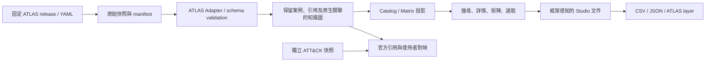

# MITRE ATLAS 整合可行性研究

查核日期：2026-10-20（Asia/Taipei）。本文件是研究與架構建議，沒有修改應用程式、安裝依賴、執行官方轉換器或連接演練環境。
本次以目前工作目錄的原始碼為本地證據；上游以官方網站、官方 GitHub 原始碼與 release 為證據。
文中的「建議／推論」代表尚未實作或驗證的設計；「待驗證」不得視為現有支援。

## 1. 結論與建議範圍

**值得整合，而且與本專案的 TTP 研究、矩陣、選取文件與來源追溯相容。**這是產品與架構判斷，並非官方對本專案的認證。
建議把 ATLAS 當成獨立知識框架，與 ATT&CK 共用呈現及文件能力；不要把它改名成 Enterprise／Mobile／ICS 的第四個官方 ATT&CK domain。
第一期加入唯讀知識庫；第二期加入可保存的 ATLAS 選取、註記及匯出；第三期加入有來源的 ATT&CK／ATLAS 交叉分析。
ATLAS 官方目前的資料範圍涵蓋 AI 系統遭攻擊、AI 能力被濫用，以及 AI 實質促成的有害自主行為；其依據包含事件及演練。[官網原始介紹][site-about]
讀取 ATLAS 知識資料，不會自動獲得 AI 攻擊執行能力，也不能由勾選矩陣推導防禦已有效。

## 2. 官方身分、版本與可引用快照

官網首頁的 ATLAS Data 連到 `/resources/info`；該頁列出 GitHub 倉庫，資料 URL 的預設值是 `mitre-atlas/atlas-data`。
該頁也明確連到 Navigator 的 **`atlas` 分支**，不能只讀 GitHub 預設 `master` 就認為查到 ATLAS 客製版。[官網資料頁原始碼][site-info]、[設定][site-env]

| 倉庫／分支 | 查核到的快照 | 用途與判斷 |
|---|---|---|
| `mitre-atlas/atlas-data`／`main` | `3259f388d19cbcca11bacf12a0ef97f4198f711b` | 建議作為主要資料、schema、轉換及 release 來源。[commit][data-commit] |
| `mitre-atlas/atlas-website`／`main` | `1d1c8f7b10856739916572bde89eb765e723c0bb` | 網站版本 5.4.1；可參考瀏覽與引用呈現。[commit][site-commit] |
| `mitre-atlas/atlas-navigator`／`atlas` | `d9da11121ff2353eee4651e6ab9d492dd67d95f2` | 官網所連的客製分支；package 為 4.7.1，不能與新資料 generator 標示的 5.3.2 混為一談。[package][nav-package] |
| `mitre-atlas/atlas-navigator-data`／`main` | `2f55d5fd4b040f109692d066bfbccda4501eb724` | 已公告 deprecated；功能遷移到 atlas-data，僅留歷史參照。[公告][nav-data] |
| `mitre-atlas/arsenal`／`main` | `2d80c59a637e32dc5d8bdc06f1b449745330b1ec` | CALDERA 的 AI 系統演練插件；獨立於知識庫整合。[README][arsenal] |

查核到的最新資料 release 是 **v2026.09**，release 頁標示 Latest；manifest 列資料格式 **6.0.0** 與檔案 `v6/ATLAS-2026.09.yaml`。
官方 release 統計為 1 個矩陣、16 個戰術、120 個技術、88 個子技術、40 個緩解措施、73 個案例；技術與子技術為分開列出的數量。[release][data-release]、[manifest][manifest]
這是查核當日可見的版本，不代表未來永遠維持此版本；release 發布時間、內容日期與 commit 日期應分別保存。

## 3. 可整合的官方能力

| 能力 | 官方現況 | 本專案建議 |
|---|---|---|
| AI 威脅知識庫 | YAML、Pydantic schema、案例及 typed relationships。[README][data-readme] | 優先加入唯讀瀏覽、搜尋、案例鏈及緩解反查。 |
| 矩陣與 layer | generator 輸出 JSON layer，常數為 Navigator 5.3.2、layer 4.5、domain `atlas-atlas`。[generator][layer-generator] | 重用目前矩陣，實作明確的 ATLAS layer profile。 |
| STIX 交換 | 官方有 `atlas_to_stix.py`；部分欄位與目前 importer 契約不一致。[converter][stix-converter] | 作為交換投影及對照；不能宣稱原樣即能匯入。 |
| Excel | atlas-data 現有 Excel 產生工具。[工具定義][pyproject] | 可參考欄位及引用設計；不必先安裝整包官方服務。 |
| 版本資料管理 API | 官方 README 提供本機 API／SQLite 的啟動與匯出流程。[README][data-readme] | 初期直接用固定快照即可，API 接入列後續選項。 |
| 知識問答 | `atlas-knowledge-base-agent` 的定位是使用知識圖譜回答 ATLAS 問題。[官方 repo][kb-agent] | 後續評估有引用的問答；不作第一期必要依賴。 |
| CALDERA 對接 | Arsenal 為 AI 系統演練插件，另有環境與工具依賴。[README][arsenal] | 沿外部 Runner 接口另案整合；本次不執行插件。 |

建議優先順序：資料／引用 → 案例／緩解 → 選取文件 → layer 互通 → 跨框架 → 問答或演練。
`atlas-navigator-data` 的舊 STIX／layer 下載路徑不宜成為新的預設更新來源。[遷移公告][nav-data]

## 4. 原生資料、ID 與關聯語義

目前原生分發是 YAML v6；其資料內容版本與格式版本分開，不能只存一個 `version` 表示兩者。[manifest][manifest]、[範例資料][native-data]
ID namespace 包含 `AML.TA####`、`AML.T####`、`AML.T####.###`、`AML.M####`、`AML.CS####`；與 ATT&CK 的 `TA####`／`T####` 分開。[schema][schemas]
矩陣順序、技術所屬戰術、父子技術、緩解對象與案例採用技術，都由具型別的關聯表達。[列舉][enums]
案例關聯還帶 tactic、step-id、leads-to 等欄位，應保留原始圖形，不能僅整理成一串不帶順序的技術 ID。[schema][schemas]

| 需保留的 ATLAS 語義 | 建議內部設計 |
|---|---|
| Framework 與 namespace | `framework_id=mitre-atlas`；外部 ID 原樣保留 `AML.*`。 |
| 原始與內部 domain 字串 | 明列上游值、標準化值及轉換版本；內部可採 `atlas-atlas`。 |
| 資料與格式版本 | 分別保存 `content_version`、`format_version`，內容版本不轉浮點數。 |
| 原生 UUID／外部 ID | 保存兩者，避免用名稱或 slug 當唯一身分。 |
| 案例 | 獨立 `CaseStudy`；Incident／Exercise 分開顯示。 |
| 證據成熟度 | 保留 Feasible／Demonstrated／Realized，作為篩選而非防禦評分。 |
| 平台 | 保留 Predictive AI／Generative AI／Agentic AI／Enterprise 等原值。 |
| 緩解分類與生命週期 | 原樣保留，不壓成一般描述欄位。 |
| references | 保留引用 ID、標題、URL，以及內文到引用的連結。 |

成熟度、平台、案例型態及緩解分類的正式值，以釘選版列舉為準；新增上游值應提示兼容狀態。[enums][enums]

## 5. 官方是否已有 ATT&CK 對照？

**有部分官方直接引用，但不能當成完整的一對一對照表。**schema 的 Tactic／Technique／Mitigation 可帶 `attack_reference`；其中含 ATT&CK ID 與 URL。[schema][schemas]
STIX converter 會把該引用加入 `source_name=mitre-attack` 的 external reference；同一 ATLAS 項目仍保留自己的 `mitre-atlas` ID。[`_attack_ref`][stix-converter]
建議關聯類型先命名為 `official_attack_reference`，呈現原始引用，不擅自宣稱兩者等價、能互換或防禦能力相同。
官方引用欄位不含 ATT&CK release 身分；本專案若用 v20.0 解讀，應另外記錄「本地解析目標版本」，不能宣稱官方已驗證此版本。
沒有找到引用時顯示「未提供官方對照」；如日後加入使用者對映，應獨立記錄作者、證據、關聯類型與審核狀態。
`--include-attack` 是資料打包功能；合併 bundle 本身不會證明所有 `AML.*` 與 `T*` 都有關聯。[converter][stix-converter]

## 6. 現有程式哪些能沿用？

以下皆為靜態原始碼檢視結果，沒有把官方資料匯入實測。

| 本地位置 | 已具備的基礎 | 限制／適配重點 |
|---|---|---|
| [domain_model.py](D:/MITREATTACK_SIMULATOR/domain_model.py:7) | 官方 ID 規則與 custom ID 規則分離；custom ID 接受點號。 | **`AML.*` 字元本身不是硬阻礙。** |
| [DomainDefinition](D:/MITREATTACK_SIMULATOR/domain_model.py:20) | 自訂 domain、kill chain、reference source。 | domain ID 只接受小寫；多個 reference source 需顯式配置。 |
| [custom_sources.py](D:/MITREATTACK_SIMULATOR/custom_sources.py:23) | 有界讀取、SHA-256、快取與 STIX 驗證。 | 目前只解析 JSON，不是原生 YAML importer。 |
| [Catalog](D:/MITREATTACK_SIMULATOR/attack_catalog.py:42) | 按 domain 產生技巧、戰術、平台與父子索引。 | 核心投影仍使用 `attack-pattern`、`x_mitre_*`。 |
| [TTPDocument](D:/MITREATTACK_SIMULATOR/ttp_documents.py:44) | dataset 身分、選取、註記、domain snapshots。 | 目前輸出語彙是 `attack`，缺 framework／format version 與案例圖保存契約。 |
| [StudioReader](D:/MITREATTACK_SIMULATOR/studio_files.py:56) | 重開時解析精確快取，文件本身不發出網路下載。 | 版本驗證只接受 `數字.數字`；應擴充後再開放 ATLAS 保存。 |
| [Navigator validation](D:/MITREATTACK_SIMULATOR/navigator_integration.py:36) | custom domain／ID 路徑，以及保留原始 layer 欄位。 | 仍需來源綁定，官方無 custom 標記的 ATLAS layer 不能直接視為已支援。 |

本地 `OFFICIAL_ID=T...` 是官方 ATT&CK 路徑的檢核；應保留，不能為 ATLAS 放寬所有官方資料驗證。
`CatalogRecord` 的來源選擇可以保留 AML 與 T 的並存引用；不應為了消除歧義而刪掉 ATT&CK external references。

## 7. 官方 STIX 不是目前的直接匯入檔：具體差異

以下來自釘選 converter `3259f388...` 的原始碼與本地 importer 對照，屬靜態兼容性結論，未執行 converter。[官方程式][stix-converter]

| 差異 | 上游證據 | 本地影響與建議 |
|---|---|---|
| ATLAS domain 大寫 | `build()` 第 249、274、296 行寫入 `ATLAS`。 | `valid_domain()` 小寫規則拒絕；adapter 保存原值並建立內部映射。 |
| matrix 缺 domain 欄位 | 第 448–458 行的 `AttackMatrix` 建構沒有 `x_mitre_domains`。 | 現有 scoped importer 依 domain 選矩陣；需由 adapter 明確綁定，而非修改原始檔。 |
| 多種 external source | `_atlas_ref` 與 `_attack_ref` 可並存。 | inference 不能唯一決定 ID source；明選 `mitre-atlas`。 |
| combined bundle 混框架 | 第 510–526 行替既有 Enterprise 物件加 `atlas-atlas` 再合併。 | 不代表 ATLAS 項目已全部規格統一；需分開 dataset 身分與 collection 版本。 |
| 原生資料語義較豐富 | 案例投影成 Campaign／uses，技術投影不包含全部原生欄位。 | 保存 YAML 原文與 graph；不要從 STIX 反推完整案例鏈。 |
| collection 版本 | 第 485 行直接使用 ATLAS collection version。 | `2026.09` 當前可通過數字格式，但未來 `2026.09.1` 不可；不得截短版本。 |

目前 `custom_catalog` 還要求 bundle 內的 collection 具有單一共同 release；combined bundle 的不同框架版本可能觸發拒絕。
這些是適配契約問題，不足以判定上游所有 release artifacts 都無法使用；實際產物仍須獨立取樣驗證。
建議主路徑採 **原生 YAML → ATLAS Adapter → 內部 Catalog 投影**；STIX 作為可選輸入或輸出格式。

## 8. Navigator 互通的實際界線

generator 釘選版第 20–22 行宣告 `5.3.2`／`4.5`／`atlas-atlas`；第 390–399 行以 metadata `atlas_data_version` 保存資料版號。[generator][layer-generator]
這表示 JSON layer 形式接近 Navigator 4.5，但 **使用 ATLAS 自訂 domain 與 AML ID**，不是官方一般 Enterprise layer。
官網所連 `atlas` 分支的設定仍載入 `ATLAS v4` 與舊 navigator-data 路徑；package 為 4.7.1。[config][nav-config]、[package][nav-package]
因此「generator 標示 5.3.2」與「官網 fork 分支」存在需驗證的版本落差；本研究不宣稱兩者完成即插即用互通。
本專案應建立 layer profile：framework、domain、內容版本、dataset hash、支援欄位與外部工具版本分開保存。
先驗證已知 layer 的 AML ID、tactic scope、score、comment、metadata；不把 `atlas_data_version` 誤當成 ATT&CK v20。
Studio 自有延伸欄位與純官方 layer 應明確分開；對外工具不支援的語義，匯出時提供損失說明與原生備份。

## 9. 建議模組與資料流

以下是待實作的設計，不是現有模組清單。

`AtlasSourceAdapter`：列出 manifest／release、取得選定檔案、保存授權與下載來源；不自行切換使用者文件的版本。
`AtlasAdapter`：只處理 YAML／schema／namespace／原始欄位；輸出穩定模型，不能依賴 Qt 或 MainWindow。
`AtlasGraph`：保留 typed relationships、案例步驟、引用、成熟度、緩解分類；索引與矩陣只讀取其投影。
`AtlasCatalogProjection`：讓既有矩陣和樹狀選取共用能力；原始圖與投影的 hash／adapter version 都需追溯。
`FrameworkDocumentModule`：負責版本化保存、舊 Studio 相容與可復原匯出；不以浮點數比較框架版本。
`CrossFrameworkMappingModule`：以官方 reference 或獨立人工對映連結兩份固定快照；不隱式聯集所有技術。

## 10. 分階段整合與驗收

### A0：來源契約與固定樣本

取得指定 release 的原生 YAML、manifest、LICENSE；保存 commit、檔案 hash、內容／格式版本與原始來源。
驗收：相同檔案可重現相同索引；損壞、錯誤 schema 或未知主要格式版本有明確診斷；現有 ATT&CK 路徑不變。

### A1：唯讀 ATLAS 知識庫

加入獨立 framework 切換、Tactic／Technique／Mitigation／CaseStudy 瀏覽與引用跳轉；保留 AML ID 與原始英文。
驗收：案例鏈、父子、矩陣順序及緩解關聯皆可追至原始資料；離線可用；未建立保存功能前不借用不完整 Studio 寫入。

### A2：選取、保存與匯出

先擴充 `VersionSpec` 與 reader，再開放 ATLAS 文件；保留既有 Studio 格式讀取，對新欄位作明確 schema migration。
驗收：`2026.09` 及格式測試用 `2026.09.1` 可無損 round trip；後者只是測試字串，不表示官方有此 release。
驗收：選取、tactic scope、註記、hash、來源及框架不漂移；官方 ATLAS layer 與自有延伸 layer 分開測試。

### A3：跨 ATT&CK／ATLAS 分析

讀取官方 attack reference，提供由案例建立研究文件、AI 威脅與企業技術並列、緩解措施與待驗證項目報告。
驗收：每條關聯顯示來源及對映種類；官方未綁定的目標 release 顯示 unknown；人工映射不偽裝成官方關聯。

### A4：可選的知識問答與演練連接

知識問答需返回快照引用；Arsenal／CALDERA 能力目錄與結果附件走獨立 connector，需另做版本及執行環境驗證。
驗收：知識庫安裝不會啟動演練；選取 TTP、存在對應 Ability、實際執行成功、防禦已驗證是四種不同狀態。
Arsenal README 的能力與系統需求包含較早的版本描述，本次沒有證明它覆蓋最新 ATLAS 或相容當前 CALDERA。[README][arsenal]

## 11. 版本、離線、語言與授權

更新建議：檢查新 release → 顯示差異 → 下載到新快照 → 驗證 → 使用者選擇遷移；不覆寫舊文件綁定的資料。
官方 `latest` 與舊版／遷移版資料路徑有所區別；部署應釘內容檔，而非長期依賴可變 `latest`。[manifest][manifest]
`--include-attack` 的官方工具會取得當下 Enterprise 資料；可重現整合應另外固定 ATT&CK 快照，記錄兩邊版本。[converter][stix-converter]
原生解析即可離線讀取；引用網站能否離線打開是另一項能力，應明示連結狀態，不自動抓取外部文章。
上游 schema 對短文字與描述有 ASCII 約束；目前未查到正式繁體中文資料分發。翻譯建議作獨立 overlay，保留英文與翻譯來源。[schema][schemas]
官方 atlas-data package 宣告 Python >=3.12 並帶 API／Excel／STIX 相依；本專案沒有 PyYAML 依賴，因此不宜為唯讀功能直接拉入全套服務。[pyproject][pyproject]、[本地依賴](D:/MITREATTACK_SIMULATOR/requirements.txt)
atlas-data 的 LICENSE 已核對為 Apache License 2.0；官網 Terms 原始碼亦列 Apache 2.0，並另外連至 ATT&CK 使用條款。[LICENSE][data-license]、[Terms][site-terms]
實作分發時保留原授權與歸屬，另確認每個附加 repo／第三方套件；ATLAS 名稱與圖示不能推定代表 MITRE 認證本產品。

## 12. 未驗證事項與決策

本次未驗證 release 二進位附件與 generator 的逐位元一致性、網站實際部署分支、完整 ATLAS layer round trip，或效能上限。
本次未執行 YAML parser、官方測試、API server、知識問答 agent、CALDERA agent 或任何 payload。
**建議決策：納入整合路線圖，以 A0／A1 作為首個交付；將原生語義與文件相容性完成後，再推進 A2／A3。**

## 官方來源

[site-about]: https://github.com/mitre-atlas/atlas-website/blob/1d1c8f7b10856739916572bde89eb765e723c0bb/src/components/home/About.vue
[site-info]: https://github.com/mitre-atlas/atlas-website/blob/1d1c8f7b10856739916572bde89eb765e723c0bb/src/views/resources/GeneralInformationView.vue
[site-env]: https://github.com/mitre-atlas/atlas-website/blob/1d1c8f7b10856739916572bde89eb765e723c0bb/src/config/env.ts
[data-commit]: https://github.com/mitre-atlas/atlas-data/commit/3259f388d19cbcca11bacf12a0ef97f4198f711b
[site-commit]: https://github.com/mitre-atlas/atlas-website/commit/1d1c8f7b10856739916572bde89eb765e723c0bb
[data-release]: https://github.com/mitre-atlas/atlas-data/releases/tag/v2026.09
[data-readme]: https://github.com/mitre-atlas/atlas-data/blob/3259f388d19cbcca11bacf12a0ef97f4198f711b/README.md
[manifest]: https://github.com/mitre-atlas/atlas-data/blob/3259f388d19cbcca11bacf12a0ef97f4198f711b/dist/manifest.yaml
[native-data]: https://github.com/mitre-atlas/atlas-data/blob/3259f388d19cbcca11bacf12a0ef97f4198f711b/dist/v6/ATLAS-2026.09.yaml
[schemas]: https://github.com/mitre-atlas/atlas-data/blob/3259f388d19cbcca11bacf12a0ef97f4198f711b/atlas/schemas.py
[enums]: https://github.com/mitre-atlas/atlas-data/blob/3259f388d19cbcca11bacf12a0ef97f4198f711b/atlas/enums.py
[stix-converter]: https://github.com/mitre-atlas/atlas-data/blob/3259f388d19cbcca11bacf12a0ef97f4198f711b/tools/atlas_to_stix.py
[layer-generator]: https://github.com/mitre-atlas/atlas-data/blob/3259f388d19cbcca11bacf12a0ef97f4198f711b/tools/generate_navigator_layers.py
[pyproject]: https://github.com/mitre-atlas/atlas-data/blob/3259f388d19cbcca11bacf12a0ef97f4198f711b/pyproject.toml
[data-license]: https://github.com/mitre-atlas/atlas-data/blob/3259f388d19cbcca11bacf12a0ef97f4198f711b/LICENSE
[site-terms]: https://github.com/mitre-atlas/atlas-website/blob/1d1c8f7b10856739916572bde89eb765e723c0bb/src/views/TermsView.vue
[nav-package]: https://github.com/mitre-atlas/atlas-navigator/blob/d9da11121ff2353eee4651e6ab9d492dd67d95f2/nav-app/package.json
[nav-config]: https://github.com/mitre-atlas/atlas-navigator/blob/d9da11121ff2353eee4651e6ab9d492dd67d95f2/nav-app/src/assets/config.json
[nav-data]: https://github.com/mitre-atlas/atlas-navigator-data/blob/2f55d5fd4b040f109692d066bfbccda4501eb724/README.md
[arsenal]: https://github.com/mitre-atlas/arsenal/blob/2d80c59a637e32dc5d8bdc06f1b449745330b1ec/README.md
[kb-agent]: https://github.com/mitre-atlas/atlas-knowledge-base-agent
