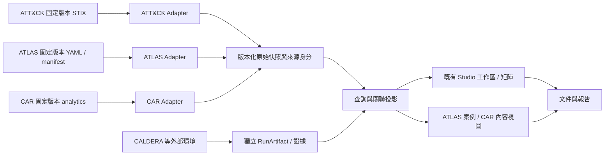

# ATT&CK 官方 Repo 與 ATLAS 整合評估

查核日期：2026-10-20（Asia/Taipei）。本文件是依目前工作樹與官方公開資料做的研究／架構建議，不是新增功能的完成宣告。

## 1. 結論

**目前最值得新增的是 CAR 偵測內容與 MITRE ATLAS 框架支援。**既有 Navigator、資料版本、保存／復原、自訂 Domain 與矩陣能力繼續增量完善；Workbench／TAXII 適合第二批協作與交換功能。CALDERA 接外部執行環境，延續既有獨立計畫／執行紀錄設計。

**ATLAS 技術上可行，也符合本專案整合 MITRE 生態系的方向，建議列為正式候選框架。**現有自訂 Domain 與非 `T####` ID 支援降低了工程門檻，但不能把 ATLAS YAML 或官方轉換出的 STIX 直接視為已相容輸入；仍需專用 Adapter、版本契約與語意保存。

所有優先度、難度與階段是本案判斷。官方上游功能、版本與限制分別見：

- [2026-10-20 ATT&CK 全 Repo 刷新與功能對映](ATTACK_REPO_INTEGRATION_2026-10-20.md)。
- [ATLAS 詳細可行性研究與來源](ATLAS_INTEGRATION_FEASIBILITY.md)。
- [CALDERA 既有研究](CALDERA_INTEGRATION_RESEARCH.md)。

本次只新增研究文件與 README 導覽；不修改程式、不下載正式資料到快取、不變更 active/latest 指標、不安裝或啟動外部工具。使用者尚未提出的個人構想仍保留待補。

## 2. 目前專案基準

### 2.1 已有能力，不能重複列為新功能

| 現況 | 本機證據 | 對整合的意義 |
| --- | --- | --- |
| 官方 Enterprise／Mobile／ICS 與歷史快照；當前 active/latest 均為 20.0 | [active.json](data/attack/active.json)、[latest.json](data/attack/latest.json)、[attack_versions.py](attack_versions.py) | 不需要為新功能重做下載器；仍需針對每種來源定義相容性 |
| Studio Open／Save／Save As／dirty baseline／關閉提示／session recovery | [studio_files.py](studio_files.py)、[studio_workspace.py](studio_workspace.py) | 可以重用文件生命週期；新框架版本與特殊內容要納入契約 |
| 原生 Flat／Side／Mini、註記、分數、公式、批次、SVG／Excel／Navigator 交換 | [attack_matrix.py](attack_matrix.py)、[layer_analysis.py](layer_analysis.py)、[navigator_integration.py](navigator_integration.py) | 可重用畫面與投影，不代表完整 Navigator 或任意新框架皆已通過驗證 |
| 資料集範圍的自訂 Domain、reference source、非官方 ID | [domain_model.py](domain_model.py)、[custom_sources.py](custom_sources.py) | `AML.T####` 本身不再是全面性的 ID 格式阻礙 |
| Strategy／Analytic／Component／Data Source／Asset 等來源與技術關聯 | [ttp_sources.py](ttp_sources.py)、[attack_catalog.py](attack_catalog.py) | CAR 增量是偵測內容與環境證據，不是從零做所有偵測關聯 |
| 英文／繁中介面、內建 Manual、版本與資訊入口 | [README.md](README.md)、[localization.py](localization.py)、[manual_page.py](manual_page.py)、[info_menu.py](info_menu.py) | 新模組沿用原生操作與翻譯機制，官方原始內容保留來源文字 |

依賴宣告目前為 PySide6 6.12.0、mitreattack-python 6.2.1、openpyxl 3.1.5；SDK 已用於 Layer 與 DiffStix，不列成「首次導入 SDK」。[requirements.txt](requirements.txt)

### 2.2 現況判讀限制

本次為原始碼、文件與資料指標的唯讀盤點，未重新執行 README 所列 audits。文件中的歷史 PASS 紀錄不是本次重新驗證。

工作樹仍在演進，實際程式優先於過時待辦。例如 README 已有 Info／Manual，而 NOTIMPLEMENTYET 的 NAV-029 仍含「沒有入口」的舊描述；這要先對帳，不應直接當缺功能。2026-10-19 的 [前次整合評估](MITRE_INTEGRATION_ASSESSMENT.md) 記錄的是當時 v19.2 指標，本次確認已是 v20.0；舊文件不代表目前未下載 v20。

## 3. 官方組織範圍

本次刷新 `mitre-attack` 公開 repository 清單仍為 21 個，名稱與 2026-10-16 快照一致；8 個封存，CARET 是 fork。來源與逐 Repo HEAD 詳見 [刷新文件](ATTACK_REPO_INTEGRATION_2026-10-20.md)；[官方組織清單](https://github.com/orgs/mitre-attack/repositories?type=all)可人工交叉核對。

ATLAS 屬 `mitre-atlas`，CALDERA 現為 `apache/caldera`，Attack Flow 與現行 TRAM 等屬 CTID 生態系。它們可整合，但不算進 `mitre-attack` 21 個 repo 的分母。不同組織的來源、授權與支援版本各自登錄。[ATLAS Data](https://github.com/mitre-atlas/atlas-data)、[CALDERA](https://github.com/apache/caldera)、[CTID](https://github.com/center-for-threat-informed-defense)

## 4. ATT&CK Repo 的整合優先序

以下「已有部分」是本機可找到對應程式；「建議新增」是尚待實作，不是上游套件已裝好就可用。

| Repo／群組 | 本案狀態 | 建議新增或完善的功能 | 接合方式 | 優先度／相對難度 |
| --- | --- | --- | --- | --- |
| [attack-stix-data](https://github.com/mitre-attack/attack-stix-data) | 已有核心整合與 v20.0 | 完善版本遷移審核、資料身分、欄位／關聯相容驗證與來源管理 | 固定 release／commit／hash 的快照 | 維持核心／中 |
| [attack-navigator](https://github.com/mitre-attack/attack-navigator) | 已有大量原生等效與 Layer 交換 | 自動漸層、完整升級審核與一對多搬移、SVG／主題細節、組織來源配置；按實際 backlog 對帳 | 格式與行為契約，延續原生畫面 | 維持核心／中 |
| [mitreattack-python](https://github.com/mitre-attack/mitreattack-python) | 已用 Layer／DiffStix | 擴充關聯／collections／格式工具，逐模組核對 STIX 2.1 與精度，不盲目升整包 | SDK Adapter | 維持核心／中 |
| [car](https://github.com/mitre-attack/car) | 無 CAR 專用來源整合 | 技術對應 analytic、hypothesis、query／偽碼、工具／sensor 與資料需求；記錄本環境是否部署、是否實測 | YAML／偵測內容目錄與引用 | 第一批／中 |
| [attack-data-model](https://github.com/mitre-attack/attack-data-model) | 尚未使用 ADM | schema diagnostics、欄位與關聯診斷；只在需要官方執行器時加入可選 Node 程序 | TypeScript schema／可選 Adapter | 支援第一批／中 |
| [caret](https://github.com/mitre-attack/caret) | 具部分清單／關聯基礎，無 CARET 式完整圖形工作流 | technique → CAR analytic → data model／sensor 的可追溯關聯視圖 | 重用功能設計，保留資料來源 | 第二批／中高 |
| [Workbench frontend](https://github.com/mitre-attack/attack-workbench-frontend)、[REST](https://github.com/mitre-attack/attack-workbench-rest-api)、[deployment](https://github.com/mitre-attack/attack-workbench-deployment) | 尚無遠端知識庫整合 | 團隊自訂物件／關聯／筆記／collections，先讀取再差異審閱與發布 | 可選獨立部署，桌面連接 | 第二批或團隊需求／高 |
| [Workbench TAXII](https://github.com/mitre-attack/attack-workbench-taxii-server) | 本機 envelope 不等於遠端 TAXII | Discovery／API roots／collections／分頁／快取，與 Workbench 分享互通 | TAXII 2.1 Adapter | 隨來源交換需求／中高 |
| [bzar](https://github.com/mitre-attack/bzar) | 尚未整合 Zeek 結果 | SMB／RPC 行為內容、Zeek notice 匯入與 TTP 證據對照 | 外部 Zeek＋artifact 匯入 | 有 Zeek 時／中高 |
| [attack-website](https://github.com/mitre-attack/attack-website) | 已有官方連結、版本資訊與手冊 | 增量補充官方內容呈現、引用與可選靜態研究報告；不重新做整站才讀資料 | 結構化資料＋來源連結／報表模板 | 較後／中 |
| [attack-arsenal](https://github.com/mitre-attack/attack-arsenal) | 尚無專用整合 | 對手模擬資源與計畫 metadata、來源追溯 | 計畫／參考目錄 | 與 CALDERA 計畫批次／中 |
| [tram（封存）](https://github.com/mitre-attack/tram) | 尚無報告映射流程 | 研究後繼 CTID TRAM，讓候選 technique 帶原文與模型版本並可人工接受 | 可選外部模型／候選結果匯入 | 獨立試點／中高 |
| [joystick](https://github.com/mitre-attack/joystick)、[attack-evals](https://github.com/mitre-attack/attack-evals) | 尚無評估資料流程 | 按輪次／場景／方法論分析結果；目前來源與再利用範圍先核實 | 獨立 EvaluationCatalog | 較後／中高 |
| [evals_caldera（封存）](https://github.com/mitre-attack/evals_caldera) | 無執行整合 | 歷史 profile／後繼 Emu 來源對照，接到獨立 Plan／Run／Artifact | 外部 CALDERA Adapter | 計畫與驗證批次／高 |
| [attack-scripts](https://github.com/mitre-attack/attack-scripts)、[attack-datasources](https://github.com/mitre-attack/attack-datasources)、[beta](https://github.com/mitre-attack/attack-datasources-stix-beta)、[attack-archives](https://github.com/mitre-attack/attack-archives) | 目前資料／工具已有若干後繼能力 | 封存格式 fixtures、歷史資料／引用相容與遺漏能力對帳；beta mock 與正式資料隔離 | 參考／相容用途，避免舊 runtime 變啟動依賴 | 較後／按缺口 |

CAR 的官方資料包含分析原理、ATT&CK 對應、偽碼與部分工具實作，適合把現有「知道對應哪些 technique」延伸成「可研究如何觀測，以及哪些條件尚未具備」。存在對映或 query 不等於本環境已部署並驗證。[CAR 官方說明](https://github.com/mitre-attack/car)

Workbench 四個 repo 構成相依的產品能力；接一份 JSON 不等於已支援其編輯、協作與部署。TAXII 支援也必須用實際協定契約驗收。[Workbench 官方說明](https://github.com/mitre-attack/attack-workbench-frontend)

## 5. ATLAS 是否應整合

### 5.1 適合的產品用途

ATLAS 是針對 AI 系統的對手戰術、技術與案例知識庫。對本案的增量價值是新增 AI 系統研究範圍，而不只是再多一個同樣資料的矩陣。[ATLAS 官方資料說明](https://github.com/mitre-atlas/atlas-data)

可規劃的操作：

1. 建立獨立 ATLAS 文件，瀏覽戰術／技術／子技術、平台、maturity 與緩解措施。
2. 選取、註記、分數、矩陣與輸出重用既有 Interface，保存原始 AML IDs。
3. 檢視案例研究的原文、步驟、技術、戰術與 `leads-to` 關聯，產生有來源的研究圖層。
4. 使用官方 `attack_reference` 顯示跨框架引用；保留不存在、未知與非一對一的情況。
5. 結合使用者自行記錄的資產、適用性與驗證證據，建立 AI 系統風險／改善研究報告。

上述為本案建議。官方 schema 與產生工具支援的內容見 [AtlasExport schema](https://github.com/mitre-atlas/atlas-data/blob/3259f388d19cbcca11bacf12a0ef97f4198f711b/atlas/schemas.py)、[Navigator layer generator](https://github.com/mitre-atlas/atlas-data/blob/3259f388d19cbcca11bacf12a0ef97f4198f711b/tools/generate_navigator_layers.py)。ATLAS 資料整合不直接構成 AI 演練執行器，也不證明已有 AI 偵測規則或控制有效性。

### 5.2 真正可接合的官方來源

| 官方來源 | 用途 | 本案建議 |
| --- | --- | --- |
| [mitre-atlas/atlas-data](https://github.com/mitre-atlas/atlas-data) | ATLAS 版本化 YAML、schema、資料管理 REST、STIX／Excel／Navigator 產生工具 | 第一來源；先離線／唯讀資料，不要求同時部署 REST＋SQLite |
| [mitre-atlas/atlas-navigator](https://github.com/mitre-atlas/atlas-navigator) | ATLAS 的 Navigator fork／呈現契約 | 用作圖層互通對照；既有 Qt 矩陣可保持原生 |
| [mitre-atlas/atlas-website](https://github.com/mitre-atlas/atlas-website) | 官方知識瀏覽、案例與引用呈現 | 作原生頁面與來源跳轉設計參考，不要求先部署整站 |
| [mitre-atlas/arsenal](https://github.com/mitre-atlas/arsenal) | CALDERA 的 AI 系統演練插件 | 後續接既有外部 Runner 設計；先驗證 Ability／環境／版本，不隨知識庫匯入執行 |
| [mitre-atlas/atlas-knowledge-base-agent](https://github.com/mitre-atlas/atlas-knowledge-base-agent) | ATLAS 知識圖譜問答 | 可選引用式問答；模型、環境與版本另驗證，不作第一期必要依賴 |
| 歷史 `atlas-navigator-data` | 已被新版資料流程取代的發行路線 | 保留舊檔相容研究，不新增為日常核心依賴；最新狀態見 ATLAS 研究 |

`atlas-data` README 現提供 v6 `AtlasExport`、內容版本與格式版本分離、STIX 與 layer 產生入口。Navigator generator 使用 custom domain `atlas-atlas`，layer format 4.5；這些名稱與共通欄位可利用，但不等於現有 SDK 與本案 reader 已完整相容。[官方 README](https://github.com/mitre-atlas/atlas-data/blob/3259f388d19cbcca11bacf12a0ef97f4198f711b/README.md)

另有兩個需分開管理的版本：目前 generator 宣告的 Navigator 目標為 5.3.2，而官方網站指向的 `atlas-navigator` `atlas` 分支 package 標為 4.7.1。產物、網站 fork 與本案 SDK 不能只因共用 Layer 4.5 就推定互通。官方網站來源鏈、固定分支與 SHA 見 [ATLAS 詳細研究](ATLAS_INTEGRATION_FEASIBILITY.md)。

### 5.3 現有程式能重用什麼、缺什麼

| 面向 | 現有基礎 | ATLAS 需要的工作 |
| --- | --- | --- |
| Framework／Domain | 可定義 dataset-scoped domain、名稱、kill chain、reference source | 把 framework 身分與 domain 分開；ATLAS、ATT&CK 各自有版本與來源 |
| 技術 ID | custom ID 可含字母、數字、底線、連字號與點 | 保留 `AML.T…`／`AML.TA…` 原值；不轉成假的 `T…`；明選 `mitre-atlas` reference source |
| 輸入 | 有界 JSON、STIX Bundle／Collection Index | 新增安全 YAML 讀取及 AtlasExport 驗證；原始 YAML／manifest 一起釘選保留 |
| 版本 | custom catalog 與 Studio reader 仍以數字一／兩段版本處理 | 保存 ATLAS `content_version` 與 `format_version`，不截斷年月／修訂段或假造 ATT&CK 版本 |
| 矩陣 | 可自訂 Domain／tactic／多 Matrix 與 occurrence | 明確轉換 tactic sequence、achieves、specializes 與平台，逐版驗收 |
| 案例／緩解 | 有 Mitigations、Campaigns、Procedure Examples 等 ATT&CK 視圖 | ATLAS case-study 是原生資料類型；保留類型、步驟、maturity 與案例圖，不只塞成文字或 campaign |
| 跨框架關聯 | 已有 source refs／直接與衍生路徑 | 以來源化 ReferenceEdge 連 ATLAS 與 ATT&CK；目標 release 未指定就標未知，不假定是 v20 |
| 保存／匯出 | Studio、CSV、Navigator、SVG、XLSX | 先定 loss report 與未知欄位保留；Studio／session 改版須可讀舊檔 |
| 翻譯 | 原生英／繁中介面 | 新標籤翻譯；原始 ATLAS 說明與使用者註記維持原內容 |

本機依據：[domain_model.py](domain_model.py)、[custom_sources.py](custom_sources.py)、[studio_files.py](studio_files.py)、[ttp_documents.py](ttp_documents.py)、[navigator_integration.py](navigator_integration.py)。這是靜態相容性檢查，尚未把官方 ATLAS 資料載入 GUI。

### 5.4 官方 STIX Converter 為何還不能直接匯入

固定研究 commit 為 `3259f388d19cbcca11bacf12a0ef97f4198f711b`。檢查 [atlas_to_stix.py](https://github.com/mitre-atlas/atlas-data/blob/3259f388d19cbcca11bacf12a0ef97f4198f711b/tools/atlas_to_stix.py) 可見：

- tactic／technique／mitigation 寫入 `x_mitre_domains=["ATLAS"]`，而本案 custom domain identifier 要求小寫。
- Matrix 建構與本案要求的 scoped `x_mitre_domains` 契約不同；不能只把匯入對話框填成 `atlas-atlas` 就補齊。
- 同時有 ATLAS 與 ATT&CK external references 的物件，需要明確 reference source，不能只挑第一個 ID。
- ATLAS collection content version 不應被壓成 ATT&CK 式數字版本。
- `--include-attack` 會取得 Enterprise 資料並合併；其程式取用最新 URL，不能當成已與本機固定 v20.0 對齊。混合 collection 也可能與現有「單一共通 release」驗證衝突。
- case-study 可被輸出成 STIX campaign，但這是格式投影；不能據此丟掉原生案例步驟與分類。

這是**兩份契約不一致**的證據，不是宣告官方工具失效。可以使用官方轉換器作參考或受控輸出；本案仍需要有來源紀錄的 normalization。不要直接修改官方原檔或把不同 Framework 混成同一權威版本。

## 6. 建議架構

圖中 Adapter／ATLAS／CAR／RunArtifact 為規劃，不是新增程式。首個 ATLAS 垂直切片可沿用現有 catalog／view，不需要先完成整份 ARCHITECTURE 的所有重構或部署新後端。

### 6.1 最小來源契約

| 資料 | 至少需要保存 |
| --- | --- |
| FrameworkSource | `framework_id`、content version、format/schema version、upstream commit、原始檔 hash、取得時間、授權來源 |
| NormalizationRecord | Adapter 版本、原始 domain／ID、內部 domain／ObjectRef、轉換設定、輸出 hash、資訊損失 |
| FrameworkObject | 原生 ID、來源型別、引用、說明與未識別欄位；投影為 STIX 時另存 projected ID |
| ReferenceEdge | source framework／object／version、target framework／ID、target version（可未知）、關聯類型、官方／使用者／推導來源 |
| CaseStudyGraph | 原生 case ID、類型、步驟、順序／leads-to、technique／tactic refs、原文引用 |
| EnvironmentEvidence | 規則／遙測／演練來源、是否部署、時間、驗證結果與 artifact；不和官方知識物件混存 |

這些是資料需求，不要求立即增加同名 class。先完成真實 Seam，避免多加一層只轉呼叫的包裝。

### 6.2 版本與格式策略

1. 各 Framework 的內容版本保存原字串，排序由該來源策略決定；ATT&CK、ATLAS、Layer、SDK 版本互不代用。
2. 第一個唯讀 ATLAS catalog 可使用獨立 manifest，尚不開放完整 Studio Save；避免用假版本繞過舊 reader。
3. 啟用 ATLAS 文件編輯前，更新 Studio／session 版本契約，保留舊版讀取及未知必要功能的拒絕行為。
4. raw YAML／STIX／CAR 原件可校驗重建；UI 正規化不得覆蓋原件。每次 normalization 都記原 domain 與欄位對映。
5. Navigator SDK 的 probe 是共通結構檢查，不是對 ATLAS AML IDs、case studies 或全部 schema 語意的完整官方驗證。
6. 沒有來源或人工決策的跨框架 edge 不自動補出；有參照也不代表語意等價或防禦有效。

官方 `atlas-data` 套件目前宣告 Python >=3.12，並包含 API／Excel／STIX 相依；本案依賴清單尚未宣告 PyYAML。因此需要先決定純資料解析需要的最小相依或隔離驗證器，再評估整包採用；不為唯讀瀏覽直接把所有後端與工具套件綁成啟動需求。[上游 pyproject](https://github.com/mitre-atlas/atlas-data/blob/3259f388d19cbcca11bacf12a0ef97f4198f711b/pyproject.toml)、[本機依賴](requirements.txt)

## 7. 推進順序與完成條件

| 階段 | 可交付內容 | 完成條件 |
| --- | --- | --- |
| I0：能力清單／現況對帳 | 核對既有 Navigator 工作與新 Framework 契約，釘來源版本 | 不把已完成能力列缺項；repo／release／資料內容版本分開 |
| I1：CAR 與 ATLAS 唯讀切片 | CAR analytic catalog；ATLAS 原始快照／schema／matrix／案例基本查詢 | 原件保留、hash 可重建、關聯與數量獨立對照、錯誤不影響既有文件、無啟動網路依賴 |
| I2：ATLAS 選取／文件／格式交換 | 註記與 scope、Studio／session 保存重開、CSV／SVG／XLSX／ATLAS layer | content／format version 不遺失；AML ID／案例／未知欄位／maturity round trip；舊 ATT&CK 文件無回歸 |
| I3：跨框架研究與防禦內容 | 官方 attack references、案例步驟圖、CAR／環境缺口／來源證據 | direct／derived／user edges 分清，未知目標版顯示未知，取消／失敗不更動原研究文件 |
| I4：團隊與交換 | Workbench 讀取→差異→發布；TAXII 2.1 | 真實端點契約、分頁、認證、衝突與離線測試；外部不可用仍可本地工作 |
| I5：外部演練／評估 | CALDERA 目錄與結果→計畫→受控 operation；其他來源結果匯入 | Plan／Run／Artifact 分離，執行與偵測證據分開；ATLAS 任一技術不自動假設存在 CALDERA Ability |

I1 的 CAR 與 ATLAS 可各自交付。I2 不必等 Workbench；I4 與 I5 也不必互相阻塞。這個順序以增量價值與現有基礎判斷，未估算工期或報價。

## 8. ATLAS 特別需要驗證的情境

- 正式 ATLAS YAML 內容版／格式版、legacy format、版本缺件、校驗失敗，以及未知欄位。
- AML technique／sub-technique／tactic／mitigation／case-study ID 的來源化保存。
- 官方原始 domain、內部 normalized domain、reference source 與多框架同時顯示。
- case graph 的 `step-id`／`leads-to`／tactic refs、maturity／platform 條件與案例種類不遺失。
- ATLAS `attack_reference` 已知／未知／已撤銷 target；不能把名稱相似視為官方映射。
- ATLAS content version 若有第三段修訂不得截斷；read-only、完整保存及 Navigator layer 往返分別驗收。
- Studio 舊文件、ATLAS 文件、混合 workspace session 與每份文件資料來源隔離。
- YAML 有界讀取、安全解析、引用／圖迴圈的診斷、取消與失敗原子性；不執行匯入內容。
- ATLAS REST API 可選，不為離線瀏覽部署 SQLite／FastAPI。AI 演練工具若另接合，需獨立功能規格。

## 9. 文件與驗證狀態

本次輸入為本機程式與官方 repo／文件，輸出絕對位置：

- `D:\MITREATTACK_SIMULATOR\ATTACK_ATLAS_INTEGRATION_PLAN.md`。
- `D:\MITREATTACK_SIMULATOR\ATTACK_REPO_INTEGRATION_2026-10-20.md`。
- `D:\MITREATTACK_SIMULATOR\ATLAS_INTEGRATION_FEASIBILITY.md`。
- `D:\MITREATTACK_SIMULATOR\README.md`：研究入口與前次快照說明。

完成標準是來源與程式結構查核、文件本機連結與覆蓋檢查；**沒有執行官方 converter、載入 ATLAS 到 GUI、部署外部 API 或重新執行應用 audit**。正式實作仍依現有要求，在讀寫前顯示絕對路徑、逐階段回報進度並同步維護同目錄 README。

## 10. 來源索引

- ATT&CK 完整逐 Repo metadata／HEAD 與用途：[本次刷新](ATTACK_REPO_INTEGRATION_2026-10-20.md)、[2026-10-16 原始盤點](MITRE_REPOSITORY_INVENTORY.md)。
- ATLAS 詳細查核與版本、授權、官方相關 repo：[ATLAS_INTEGRATION_FEASIBILITY.md](ATLAS_INTEGRATION_FEASIBILITY.md)。
- 官方入口：[ATT&CK GitHub](https://github.com/mitre-attack)、[ATLAS](https://atlas.mitre.org/)、[ATLAS GitHub](https://github.com/mitre-atlas)。
- 官方 ATLAS 固定來源：[README](https://github.com/mitre-atlas/atlas-data/blob/3259f388d19cbcca11bacf12a0ef97f4198f711b/README.md)、[schema](https://github.com/mitre-atlas/atlas-data/blob/3259f388d19cbcca11bacf12a0ef97f4198f711b/atlas/schemas.py)、[STIX converter](https://github.com/mitre-atlas/atlas-data/blob/3259f388d19cbcca11bacf12a0ef97f4198f711b/tools/atlas_to_stix.py)、[Navigator generator](https://github.com/mitre-atlas/atlas-data/blob/3259f388d19cbcca11bacf12a0ef97f4198f711b/tools/generate_navigator_layers.py)。

本文件中的優先度、模型與 I0–I5 是本專案提案；不代表 MITRE 官方架構要求、對本案背書或已驗證產品能力。
