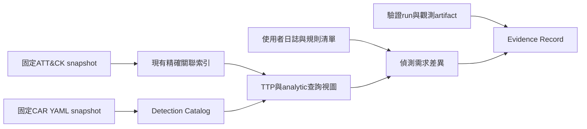

# 依目前專案重新評估 MITRE ATT&CK Repo 整合

查核日期：2026-10-20（Asia/Taipei）。本文件只記研究、現況對照及建議，沒有實作或執行外部整合。
本地輸入：`D:\MITREATTACK_SIMULATOR\README.md`、`NOTIMPLEMENTYET.md`、`ttp_sources.py`、`navigator_integration.py`、`requirements.txt`及資料版本指標。
輸出：`D:\MITREATTACK_SIMULATOR\ATTACK_REPO_INTEGRATION_2026-10-20.md`。

## 1. 結論與優先順序

目前最有增量價值的是：**CAR偵測內容與證據→關聯研究視圖→版本化格式驗證→選配Workbench/TAXII**。
Navigator已整合大量功能，接下來應補可驗收的剩餘差異；不應重複建議已完成的保存、多領域、語言或custom domain。
整合目標應是能力覆蓋與一致工作流程，不是把21個repo全部clone、內嵌或同時啟動。

| 優先 | 可交付成果 | 與現況的差異 |
|---|---|---|
| P1 | CAR內容、query/資料需求與TTP映射 | 現在有官方STIX偵測關聯；新增另一知識庫的實作與證據 |
| P1 | 技術→策略→analytic→component→CAR/規則的可追溯視圖 | 延用現有direct/derived路徑及來源預覽，增加跨catalog查詢 |
| P1 | 完成Navigator剩餘差異與逐模組schema/SDK驗證 | 延用已完成操作，避免被新的上游領域擴張破壞 |
| P2 | TAXII2.1讀取與多來源清單 | local envelope不等於remote協定 |
| P2 | 選配Workbench知識編輯/協作 | 對自訂STIX物件作草稿、差異與發布，不混同layer註記 |
| P3 | 報告候選映射、評估/演練計畫與觀測artifact | 後繼repo/外部runtime需獨立研究及驗收 |

優先度是本案建議；不是MITRE官方路線圖。ATLAS不在mitre-attack組織分母內，由獨立研究確認，不能因custom domain可載入就宣稱已完整相容。

## 2. 完整組織清單與上次差異

本次以GitHub官方連線的repository search，執行`org:mitre-attack is:public fork:true`，每頁100筆：第1頁21、第2頁0，無archive filter；再逐一讀repository metadata與default branch HEAD。
清單與2026-10-16相同：**21個public，8個archived、13個未封存；caret唯一fork**。沒有發現新增、移出或archive/fork狀態改變。
完整性僅限當次公開可見repo；搜尋索引可能有延遲。官方[組織all頁](https://github.com/orgs/mitre-attack/repositories?type=all)也顯示21，但web抓取為快取，不能拿其舊更新日期替代本次API。
人工可復核[官方搜尋](https://github.com/search?q=org%3Amitre-attack+is%3Apublic+fork%3Atrue&type=repositories)。逐庫狀態可由`https://api.github.com/repos/mitre-attack/<name>`核對；固定HEAD見下表。

| Repo | Archive/Fork | default HEAD（固定來源） | HEAD日期UTC | 與10/16 |
|---|---|---|---|---|
| attack-stix-data | 未封存 / source | [c2494b29dd26](https://github.com/mitre-attack/attack-stix-data/commit/c2494b29dd268c46a5d0ea0990553e4327cd2253) | 2026-10-13 | 相同 |
| attack-navigator | 未封存 / source | [734a1caba29f](https://github.com/mitre-attack/attack-navigator/commit/734a1caba29fcd51f20b9ca239ce652b3354a47e) | 2026-09-10 | 相同 |
| mitreattack-python | 未封存 / source | [2548d0ae1644](https://github.com/mitre-attack/mitreattack-python/commit/2548d0ae164461b5fb00f21f7ac0f3fe1b09d683) | 2026-10-13 | 相同 |
| attack-data-model | 未封存 / source | [2b50c256e04d](https://github.com/mitre-attack/attack-data-model/commit/2b50c256e04d3633a96f3c49b31c921c8843e9e4) | 2026-06-25 | 相同 |
| car | 未封存 / source | [1b922fe1527d](https://github.com/mitre-attack/car/commit/1b922fe1527d956e222a99473472e594f10f610b) | 2025-05-16 | 相同 |
| caret | 未封存 / fork | [a9db8c8636d8](https://github.com/mitre-attack/caret/commit/a9db8c8636d8e71cc30780669866524d6b30d0f0) | 2020-01-17 | 相同 |
| attack-workbench-rest-api | 未封存 / source | [98c75d1788c4](https://github.com/mitre-attack/attack-workbench-rest-api/commit/98c75d1788c4d3e14600041a25eb02e696055822) | 2026-10-19 | 有變 |
| attack-workbench-frontend | 未封存 / source | [5d1f16a98bef](https://github.com/mitre-attack/attack-workbench-frontend/commit/5d1f16a98bef20852cb7a04ea129d84d6934868a) | 2026-07-24 | 相同 |
| attack-workbench-taxii-server | 未封存 / source | [5ebe3f8bbaf5](https://github.com/mitre-attack/attack-workbench-taxii-server/commit/5ebe3f8bbaf56a8cf0dd96e8643dd5d6a383f3ba) | 2026-06-17 | 相同 |
| attack-workbench-deployment | 未封存 / source | [d3b797582910](https://github.com/mitre-attack/attack-workbench-deployment/commit/d3b79758291028b712c4efbf5e5889a35cd7816f) | 2026-10-16 | 有變 |
| bzar | 未封存 / source | [59bae4a0e784](https://github.com/mitre-attack/bzar/commit/59bae4a0e7849a75fa5ea86a206f10f3ce8dbe22) | 2024-06-26 | 相同 |
| attack-website | 未封存 / source | [cafe596a6e10](https://github.com/mitre-attack/attack-website/commit/cafe596a6e101ba7ff2d8c1b3e3f976f97782dbe) | 2026-10-14 | 相同 |
| attack-arsenal | 未封存 / source | [201db70f4036](https://github.com/mitre-attack/attack-arsenal/commit/201db70f403676cc8ec090035f17d98cf9995244) | 2021-04-20 | 相同 |
| attack-scripts | Archived / source | [445f5614e7a3](https://github.com/mitre-attack/attack-scripts/commit/445f5614e7a389d92b4e1984f203fc59604cc518) | 2023-12-11 | 相同 |
| attack-datasources | Archived / source | [5d50f731de44](https://github.com/mitre-attack/attack-datasources/commit/5d50f731de441eb09078623a2c29cc3420a01949) | 2023-09-13 | 相同 |
| attack-datasources-stix-beta | Archived / source | [c6c37a2fddd6](https://github.com/mitre-attack/attack-datasources-stix-beta/commit/c6c37a2fddd6f51bf74862f1cee98d240c6810ea) | 2023-09-13 | 相同 |
| tram | Archived / source | [252603f09898](https://github.com/mitre-attack/tram/commit/252603f09898d69fc753c5c7eccab244d6d084ba) | 2021-10-06 | 相同 |
| joystick | Archived / source | [1829d7b7284c](https://github.com/mitre-attack/joystick/commit/1829d7b7284caefda0516c6d57271fa64798e284) | 2023-09-13 | 相同 |
| attack-evals | Archived / source | [d4879476337a](https://github.com/mitre-attack/attack-evals/commit/d4879476337a46a71bd37d073cc31379defb57d3) | 2021-04-30 | 相同 |
| evals_caldera | Archived / source | [8721102af46a](https://github.com/mitre-attack/evals_caldera/commit/8721102af46ad394d0bc7f2596d122c59eb065b6) | 2023-09-14 | 相同 |
| attack-archives | Archived / source | [f60e76afba4a](https://github.com/mitre-attack/attack-archives/commit/f60e76afba4ad6f6e7fe2d26b156c9b898bc7db9) | 2020-07-21 | 相同 |

只有Workbench REST API及deployment的default HEAD改變；本次已重讀兩者固定HEAD README。其他19庫沿用10/16已讀README/授權/能力證據，先確認HEAD未變再復用。
HEAD不是release，更新commit不等於新增使用者功能。Workbench兩個新HEAD的執行相容性未驗證；本次不宣稱相同API保證。
原始詳細授權與能力附錄：[10/16完整盤點](D:/MITREATTACK_SIMULATOR/MITRE_REPOSITORY_INVENTORY.md)。

## 3. 本機基準：這些能力已存在

- 官方預設資料已是Enterprise/Mobile/ICS **v20.0**；由本地latest.json直接確認，不沿用前次v19.2敘述。
- Studio Open/Save/Save As、未存檔提醒、復原、Navigator單/多層JSON、SVG及單/多表Excel已存在。
- 原生Flat/Side/Mini、註記/分數/彙總、來源搜尋/批次選取、Asset/Detection Strategy/Component/Data Source、懸停預覽已有。
- NAV015多層原子匯入、NAV016 customDataURL審查與精確hash綁定、NAV017 custom domains/多Matrix有序聯集已有。
- NAV018有限純量與NAV019缺值/範圍的Navigator相容模式已有固定golden；不是全mathjs/全layerOperation承諾。
- 英文/繁中即時切換、內建Manual/F1與Info版本說明已有；不可再次以『缺程式內說明』當確定缺口。
- `requirements.txt`已pin `mitreattack-python==6.2.1`；程式已使用`navlayers.core.Layer`及`diffStix`，不是尚未導入SDK。

本機證據：[README](D:/MITREATTACK_SIMULATOR/README.md)、[latest.json](D:/MITREATTACK_SIMULATOR/data/attack/latest.json)、[現有待辦](D:/MITREATTACK_SIMULATOR/NOTIMPLEMENTYET.md)、[SDK使用處](D:/MITREATTACK_SIMULATOR/navigator_integration.py)、[套件版本](D:/MITREATTACK_SIMULATOR/requirements.txt)。
本次只讀文件及程式，不重跑業務測試；README列出的測試數是既有驗證紀錄，不是本次新增測試結果。

特別對帳：NOTIMPLEMENTYET的NAV029仍寫沒有Help/Changelog入口，與最新README及Info/Manual實作不一致，應先更新追蹤狀態，再判定是否有剩餘內容缺口。

## 4. 21個repo的能力、目前程度及接合方式

狀態『未接合』指本案尚無該repo的完整資料/服務路徑；『部分已整合』不等於上游全功能。P1先做，P2選配，P3獨立試點，R只參考。

| Repo | 優先／目前程度 | 可補能力及現況差異 | 建議整合方式 | 官方來源 |
|---|---|---|---|---|
| attack-stix-data | P1／持續；已整合 | 三領域v20.0、歷史snapshot、SHA/commit與自訂來源框架已用；補schema版本、跨來源血緣及更新相容性驗收。 | Data Provider；保留原始bundle與不可變snapshot。 | [README](https://github.com/mitre-attack/attack-stix-data/blob/c2494b29dd268c46a5d0ea0990553e4327cd2253/README.md) |
| attack-navigator | P1／收尾；大量已實作 | NAV001–019/030已記完成；補NAV020結果漸層、021–024升級審查、025–028輸出/主題、031–034來源/組織設定；029須先對帳。 | 沿用原生Qt與layer互通，不先重建Angular。 | [README](https://github.com/mitre-attack/attack-navigator/blob/734a1caba29fcd51f20b9ca239ce652b3354a47e/README.md) |
| mitreattack-python | P1／深化；部分已整合 | 本案pin6.2.1，已用Layer與diffStix；上游6.3.1。擴充collection工具、完整資料Excel與差異報告須逐模組驗證。 | Python Adapter；不把核心STIX2.0限制套到所有模組，亦不宣稱全部STIX2.1已相容。 | [README](https://github.com/mitre-attack/mitreattack-python/blob/2548d0ae164461b5fb00f21f7ac0f3fe1b09d683/README.md) |
| attack-data-model | P1／研究；未接合 | TypeScript/Zod STIX2.1 parsing/validation/relations可作自訂catalog診斷；README相容表較舊，TAXII列coming soon。 | Schema基準或可選Node驗證程序；不可當Python套件。 | [README](https://github.com/mitre-attack/attack-data-model/blob/2b50c256e04d3633a96f3c49b31c921c8843e9e4/README.md) |
| car | P1／新增；未接合CAR | 已有官方策略/analytic/component關聯；尚未匯入CAR YAML、hypothesis、query實作、sensor與驗證證據。 | Detection Catalog與TTP關聯；保留CAR命名空間、query工具/版本與來源。 | [README](https://github.com/mitre-attack/car/blob/1b922fe1527d956e222a99473472e594f10f610b/README.md) |
| caret | P1／概念；未接合 | 取groups/techniques→analytics/data/sensors的防禦關聯視圖；本機已有來源預覽，尚無完整此圖譜。 | 參考圖模型與查詢，不搬gulp/bower舊UI；fork與歷史依賴隔離。 | [README](https://github.com/mitre-attack/caret/blob/a9db8c8636d8e71cc30780669866524d6b30d0f0/README.md) |
| attack-workbench-rest-api | P2／選配；未接合 | 需要自訂知識物件/關聯CRUD、collections、協作時接合；最新HEAD有變，不能沿用舊API契約未驗證。 | Remote Adapter；本地draft→diff/conflict→明確publish，MongoDB不綁桌面。 | [README](https://github.com/mitre-attack/attack-workbench-rest-api/blob/98c75d1788c4d3e14600041a25eb02e696055822/README.md) |
| attack-workbench-frontend | P2／選配；未接合 | 可選官方知識編輯/協作介面；本案本機Notes與layer annotations不等同Workbench物件編輯。 | 深連結/外部UI或REST互通；不複製Angular到Qt核心。 | [README](https://github.com/mitre-attack/attack-workbench-frontend/blob/5d1f16a98bef20852cb7a04ea129d84d6934868a/README.md) |
| attack-workbench-taxii-server | P2／選配；未接合 | 本機只支援TAXII envelope copy；缺discovery、API roots、collections、pagination與版本記錄。 | TAXII2.1 ingestion先行；分享透過Workbench服務另驗證。 | [README](https://github.com/mitre-attack/attack-workbench-taxii-server/blob/5ebe3f8bbaf56a8cf0dd96e8643dd5d6a383f3ba/README.md) |
| attack-workbench-deployment | P2／選配；未接合 | Docker/Compose、Kubernetes部署模板；本次HEAD更新但README能力不代表已在本環境驗證。 | 獨立部署profile與health檢查；不將Docker作日常開檔依賴。 | [README](https://github.com/mitre-attack/attack-workbench-deployment/blob/d3b79758291028b712c4efbf5e5889a35cd7816f/README.md) |
| bzar | P2／選配；未接合 | Zeek SMB/DCE-RPC analytics與notice可成偵測參考/觀測artifact；需環境調校。 | 先metadata及log匯入，再評估外部Zeek；非桌面內建SIEM引擎。 | [README](https://github.com/mitre-attack/bzar/blob/59bae4a0e7849a75fa5ea86a206f10f3ce8dbe22/README.md) |
| attack-website | P2／選擇；部分概念已有 | Info/Manual/官方連結已有；可增加版本固定研究頁/引用與客製內容，完整網站建置非必要。 | STIX結構化資料優先；網站用作來源與可選靜態發佈。 | [README](https://github.com/mitre-attack/attack-website/blob/cafe596a6e101ba7ff2d8c1b3e3f976f97782dbe/README.md) |
| attack-arsenal | P3／資源；未接合 | 對手模擬資源/計畫metadata可關聯TTP；不是一個完整可內嵌執行引擎。 | 資源Catalog/EmulationPlan；外部Runner另立驗收。 | [README](https://github.com/mitre-attack/attack-arsenal/blob/201db70f403676cc8ec090035f17d98cf9995244/README.md) |
| attack-scripts | R／參考；封存 | standalone處理/視覺化與layer範例；官方指向mitreattack-python。 | 只補仍缺的示例，不新增對封存script的runtime依賴。 | [README](https://github.com/mitre-attack/attack-scripts/blob/445f5614e7a389d92b4e1984f203fc59604cc518/README.md) |
| attack-datasources | R／參考；封存 | Data Sources/Components方法論與舊YAML/notebook；現有正式映射已在本案。 | 研究/歷史轉換參考；正式內容讀版本化STIX。 | [README](https://github.com/mitre-attack/attack-datasources/blob/5d50f731de441eb09078623a2c29cc3420a01949/README.md) |
| attack-datasources-stix-beta | R／隔離；封存 | 任意隨機生成mock資料；官方明示不代表正式對應。 | 僅隔離fixture/規格歷史，不匯入正式知識庫。 | [README](https://github.com/mitre-attack/attack-datasources-stix-beta/blob/c6c37a2fddd6f51bf74862f1cee98d240c6810ea/README.md) |
| tram | P3／後繼；封存/已移轉 | 舊版報告→TTP mapping；現行能力要看CTID後繼，不把舊repo當最新ML。 | 候選映射Result匯入/可選ML程序；人工接受，不自動寫成事實。 | [README](https://github.com/mitre-attack/tram/blob/252603f09898d69fc753c5c7eccab244d6d084ba/README.md) |
| joystick | P3／歷史；封存 | Evaluations結果分析與精簡視圖可參考；不能直接拿舊輪次做現行供應商總排名。 | Evaluation Catalog與版本/輪次/方法論上下文。 | [README](https://github.com/mitre-attack/joystick/blob/1829d7b7284caefda0516c6d57271fa64798e284/README.md) |
| attack-evals | P3／待查；封存/已移轉 | 舊網站移往attackevals渠道；當前資料可取得性與再散布條款須確認。 | 先來源鏈/引用；不打包尚未核對的歷史內容。 | [README](https://github.com/mitre-attack/attack-evals/blob/d4879476337a46a71bd37d073cc31379defb57d3/README.md) |
| evals_caldera | P3／後繼；封存 | Round1 APT3插件；README指向Emu，非目前Caldera支援承諾。 | 計畫metadata；後繼Emu/Caldera屬組織外選配。 | [README](https://github.com/mitre-attack/evals_caldera/blob/8721102af46ad394d0bc7f2596d122c59eb065b6/README.md) |
| attack-archives | R／參考；封存 | 舊網站快照/archives.json；已由website versioning取代。 | 只保留舊引用轉接，不設日常同步依賴。 | [README](https://github.com/mitre-attack/attack-archives/blob/f60e76afba4ad6f6e7fe2d26b156c9b898bc7db9/README.md) |

## 5. 第一主線：從已有偵測關聯延伸到CAR與證據

現有`ttp_sources.py`已用真實STIX refs處理直接detects、Strategy→Analytic→Component，以及Data Source元件聯集，並保留`mapping_type`和`via_refs`。
因此不能再說『缺Data Source分組』『沒有Detection Strategy關聯』。真正新增的是CAR analytic及環境驗證資料的獨立生命週期。

建議最小資料流：

CAR的官方README列hypothesis、information domain、TTP references、偽碼、unit test及工具實作；analytics在YAML目錄。
優先匯入CAR ID、description/hypothesis、attack mappings、required data、query工具/版本、來源引用；先不執行附帶測試。
來源：[CAR README](https://github.com/mitre-attack/car/blob/1b922fe1527d956e222a99473472e594f10f610b/README.md)、[analytics](https://github.com/mitre-attack/car/tree/1b922fe1527d956e222a99473472e594f10f610b/analytics)。

本案建議：Evidence Record分開記『有對應內容』『環境有資料』『已部署規則』『已觸發/觀測』『最後驗證日期』，不能把mapping數量直接當防禦有效率。
每條mapping保留原始邊/推導路徑/來源版本；CAR query、官方STIX Analytic與本機DetectionRule各自命名空間，不靠名稱合併。
CARET可提供groups/techniques→analytics/data/sensors的視圖概念；不用繼承其舊gulp/bower前端或把fork當活躍產品。
來源：[CARET README](https://github.com/mitre-attack/caret/blob/a9db8c8636d8e71cc30780669866524d6b30d0f0/README.md)、[本機來源索引](D:/MITREATTACK_SIMULATOR/ttp_sources.py)。

驗收建議：同名不同ID不混、revoked邊不當active、未知/跨版本對應明標unresolved；有CAR mapping不自動改本案選取/註記或官方STIX。

## 6. 第二主線：Navigator收尾與SDK／格式相容

仍有清楚依據的Navigator增量是：

- NAV020：公式結果min/max與0/1透明藍特例；目前已有漸層，差在自動結果模式，不是缺顏色。
- NAV021–024：新增技術完整分類、閱讀式前後內容、一對多tactic映射衝突、分類進度/摘要。
- NAV025–028：SVG light/dark、紙張/方向預設、字級/自動適字/溢位，以及應用主題。
- NAV031–034：TAXII讀取、組織多來源清單、功能白名單、啟動圖層/banner/可攜配置。
- NAV035屬Web分享架構選擇；桌面程式不需要為『iframe等效』先改成Web。

現況及驗收證據：[NOTIMPLEMENTYET](D:/MITREATTACK_SIMULATOR/NOTIMPLEMENTYET.md)。官方參考：[Navigator USAGE](https://github.com/mitre-attack/attack-navigator/blob/734a1caba29fcd51f20b9ca239ce652b3354a47e/USAGE.md)、[公式service v5.3.2](https://github.com/mitre-attack/attack-navigator/blob/v5.3.2/nav-app/src/app/services/viewmodels.service.ts)。

官方SDK上游HEAD pyproject為6.3.1，本機6.2.1；是否升級須靠目前格式fixtures，而非為追最新版自動換套件。
核心MitreAttackData明列STIX2.0；本案DiffStix已處理本地STIX2.1。兩者不能互相推出整套SDK都不相容或都相容。
來源：[上游pyproject](https://github.com/mitre-attack/mitreattack-python/blob/2548d0ae164461b5fb00f21f7ac0f3fe1b09d683/pyproject.toml)、[MitreAttackData](https://github.com/mitre-attack/mitreattack-python/blob/2548d0ae164461b5fb00f21f7ac0f3fe1b09d683/mitreattack/stix20/MitreAttackData.py)、[本機compare_versions](D:/MITREATTACK_SIMULATOR/navigator_integration.py)。

ADM是TypeScript/Zod STIX2.1庫，適合作結構診斷與規格參考；其README相容表/taxii狀態需固定release確認。
ATT&CK release、STIX version、ATT&CK spec、Navigator layer schema、SDK/ADM package版本須各自記錄；custom domain可讀不等於任意STIX authoring。
來源：[ADM README](https://github.com/mitre-attack/attack-data-model/blob/2b50c256e04d3633a96f3c49b31c921c8843e9e4/README.md)、[spec version](https://github.com/mitre-attack/attack-data-model/blob/2b50c256e04d3633a96f3c49b31c921c8843e9e4/ATTACK_SPEC_VERSION)。

## 7. 選配遠端：Workbench／TAXII

Workbench frontend、REST、MongoDB及可選TAXII共同形成服務產品；四個repo不應各建一個重複本案狀態的模組。
建議先TAXII2.1 ingestion：discovery→API root→collection/version明確選擇→pagination→raw snapshot/hash→現有catalog解析。
再做Workbench Draft/SyncPlan：認證讀取→本機草稿→衝突預覽→明確publish，保留遠端物件revision與本地來源。
來源：[REST README](https://github.com/mitre-attack/attack-workbench-rest-api/blob/98c75d1788c4d3e14600041a25eb02e696055822/README.md)、[TAXII README](https://github.com/mitre-attack/attack-workbench-taxii-server/blob/5ebe3f8bbaf56a8cf0dd96e8643dd5d6a383f3ba/README.md)、[deployment README](https://github.com/mitre-attack/attack-workbench-deployment/blob/d3b79758291028b712c4efbf5e5889a35cd7816f/README.md)。

沒有服務、沒有認證或不在線時，本機文件/矩陣/快照查詢仍正常；client connector與部署profile分離。
本地TAXII envelope是剪貼簿格式，不含discovery、remote auth、pagination或sharing權限。來源：[本機stix_clipboard](D:/MITREATTACK_SIMULATOR/stix_clipboard.py)。

## 8. 組織外後繼與範圍限制

| 補充來源 | 與21庫的關係 | 建議／查核邊界 |
|---|---|---|
| [CTID TRAM](https://github.com/center-for-threat-informed-defense/tram) | 舊tram README指定後繼 | 候選TTP映射/註記模型；需查語言、涵蓋技術及資料版本，不承諾中文或全技術 |
| [mitre/cti](https://github.com/mitre/cti) | STIX2.0官方ATT&CK/CAPEC | 若某SDK模組需要STIX2.0，作獨立provider；不把CAPEC混成ATT&CK technique |
| [mitre/emu](https://github.com/mitre/emu)、[apache/caldera](https://github.com/apache/caldera) | evals_caldera後繼及外部模擬框架 | Plan/Run/Artifact分離；先目錄/既有報告；operation建立會排程執行，不是dry-run |
| [attackevals渠道](https://github.com/attackevals/website) | attack-evals README指定後繼 | 現行資料/授權仍待查；歷史輪次先作帶方法論的結果研究 |
| ATLAS | 不在本次mitre-attack分母 | 由獨立官方資料/模型研究決定adapter；本文件不宣告完整接合 |

來源鏈：[舊TRAM README](https://github.com/mitre-attack/tram/blob/252603f09898d69fc753c5c7eccab244d6d084ba/README.md)、[舊Caldera插件README](https://github.com/mitre-attack/evals_caldera/blob/8721102af46ad394d0bc7f2596d122c59eb065b6/README.md)、[舊evals README](https://github.com/mitre-attack/attack-evals/blob/d4879476337a46a71bd37d073cc31379defb57d3/README.md)、[本案Caldera研究](D:/MITREATTACK_SIMULATOR/CALDERA_INTEGRATION_RESEARCH.md)。

## 9. 工程與授權驗收門檻

- 每個adapter記來源repo/ref、license/notice、資料/格式/服務版本、loss report、fixtures、最後驗證日期。
- 大多程式為Apache-2.0；BZAR為BSD-3-Clause；ATT&CK資料為MITRE自訂許可；CARET含MIT型條款及政府NOTICE；attack-evals再利用範圍未確認。
- fork/archived不等於不能研究；卻不宜作沒有替代路徑的基礎runtime。beta隨機內容須隔離，不能算正式覆蓋。
- 進度沿用本案要求：事前輸入/輸出絕對路徑，取得→解析→驗證→審查→原子發布，取消/錯誤不留下半成品。
- 既有功能用現有fixtures回歸；跨repo新增能力先做契約/資料映射驗收，不能用本次研究代替安裝或功能測試。

授權固定檔案及不確定項詳見[完整盤點](D:/MITREATTACK_SIMULATOR/MITRE_REPOSITORY_INVENTORY.md)；兩個更新repo本次README仍列Apache-2.0，未完成其新HEAD全部第三方依賴審查。
本研究只新增此檔案，不修改README、ARCHITECTURE、其他程式或資料指標；不安裝上游、不下載執行內容、不執行業務測試。

