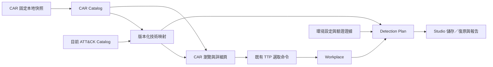

# CAR 整合規劃

調查日期：2026-10-21。本文為架構提案，沒有實作 CAR 匯入或修改應用程式。

2026-10-21 需求更新：正式工程驗收以 [CAR_REQUIREMENTS.md](CAR_REQUIREMENTS.md) 為準。使用者已指定六欄排序清單、官方父／子技術關聯互通、Data Model／Sensors 獨立導覽圖示，以及 **CAR Analytic 本身納入 Workplace**。分析選取、原生儲存／讀入與復原是本次必做；環境部署／驗證證據留待後續。CAR 是獨立內容類型，不新增威脅矩陣。

## 結論與定位

可以整合，而且目前專案已有足夠基礎。建議把 CAR 作為「偵測分析知識庫與偵測規劃」，與 ATT&CK／ATLAS 的技術選取連動。CAR ID 代表偵測分析，不應放入 TTP ID 集合，也不需要新增第三個威脅矩陣或框架 Toggle。

CAR 提供分析理由、ATT&CK 關聯、不同工具的實作，以及資料模型與感測器參考；官方也區分攻擊行為知識與情境相關的偵測方法。[官方介紹](https://github.com/mitre-attack/car#readme)

上游固定快照、欄位、限制與永久來源見 [CAR_UPSTREAM_RESEARCH.md](CAR_UPSTREAM_RESEARCH.md)。以下新增檔名、介面及資料路徑均為建議，尚未建立相對應程式。

## 現有專案可沿用之處

| 現有位置 | 已存在能力 | CAR 接入方式 |
| --- | --- | --- |
| `attack_catalog.py` | Detections 下已有 Detection Strategies、Analytics、Data Components、Data Sources；具版本與領域身分 | 保留 ATT&CK 原始資料，CAR 使用自己的 Catalog |
| `ttp_sources.py` | 精確 STIX 關聯；策略→分析→資料元件路徑 | 沿用可追溯關聯的設計；CAR external ID 解析需獨立模組 |
| `selection_workspace.py` | 矩陣預覽、批次加入／移除與保留註記 | 讓 CAR 映射結果進入既有選取流程；移除不得展開技術家族 |
| `ttp_documents.py` | 文件選取、註記、版本、獨立 ATLAS companion | 增加獨立的偵測計畫資料，不混入 TTP 註記 |
| `studio_files.py`、`studio_workspace.py` | 明確版本還原、原子儲存、復原快照 | 偵測計畫納入儲存、複製、dirty tracking 及復原 |
| `framework_io.py` | ATT&CK／ATLAS 選擇性讀寫，預設皆開啟 | 維持兩框架語意，另提供是否包含偵測計畫的選項 |

以上為本次閱讀本機原始碼所得。目前 `data/attack/active.json` 與 `latest.json` 都指向 ATT&CK 20.0；本次未發現 CAR Python 匯入模組。

## 建議使用流程與介面

1. 左側新增 **CAR Analytics** 入口，保留 ATT&CK Detections 原有分類；兩者在技術詳細頁彙整顯示，清楚標明來源。
2. CAR 清單可依 ID、名稱、平台、工具類型、資料需求及「只看已選 TTP」篩選。
3. 詳細頁顯示分析描述／假設、原始 coverage、實作語言或工具、程式碼或外部連結、資料需求、感測器候選、來源版本。缺少欄位時顯示未提供，不補造內容。
4. 頁面上方提供「加入對應 ATT&CK TTP」與「移除對應 ATT&CK TTP」。操作前列出精確目標與數量；移除只取消這些技術的選取，保留全部註記及 ATLAS 選取。
5. Selected Techniques 的右鍵選單新增「查看相關 CAR Analytics」；單次點擊及 Ctrl／Shift 多選維持目前語意。
6. Workplace 新增 **Detection Plan** 頁：已選 TTP → 候選 CAR 分析 → 實作選擇 → 資料需求 → 使用者環境狀態／驗證證據。

例如選取 `T1036.003`，可找到 `CAR-2013-05-009`，檢視其不同工具實作，以及 `process/create/exe`、`process/create/md5_hash` 需求。部分 Sigma 實作只有外部連結，因此應提供「開啟來源」，不能一律當作可直接匯出執行的規則。[官方範例](https://github.com/mitre-attack/car/blob/1b922fe1527d956e222a99473472e594f10f610b/analytics/CAR-2013-05-009.yaml)

## 模組責任與依賴

| 建議模組 | 責任 | 依賴與限制 |
| --- | --- | --- |
| `car_catalog.py` | 讀取固定本地快照、驗證 YAML／雜湊、保存原始內容、建立分析／實作／資料模型／感測器索引 | 使用現有 PyYAML；不依賴 Qt 或修改選取資料 |
| `car_mapping.py` | 將 CAR coverage 對應至指定 ATT&CK dataset、domain、技術與戰術；回傳映射及異常 | 接收 CAR Catalog 與 ATT&CK Catalog；不依名稱猜測 |
| `detection_plan.py` | 保存選用分析與實作、環境資料需求判定、部署與驗證證據 | 以 CAR 快照、ATT&CK dataset、TTP、環境為身分；不依賴 Qt |
| `car_workspace.py` | 清單、搜尋、詳細頁、矩陣預覽與選取命令 | 呼叫上述模組與既有選取介面；不自行解析 YAML |
| `detection_exports.py` | 偵測計畫 JSON／CSV，以及明確標示意義的 Navigator 檢視 | 使用解析結果與計畫；不從顏色反推驗證狀態 |

不必先重寫整個 `main.py` 或建立通用外掛平台。先把檔案讀取、映射及環境狀態放在可獨立驗證的模組，再接入既有 UI。

## 資料身分與映射規則

- CAR 分析使用 `CAR-YYYY-MM-NNN` 原始 ID，加上來源 commit／檔案 SHA-256；實作保留所屬分析與快照中的定位，不假設 `name` 必填或唯一。
- 覆蓋關聯保留 `technique`、`subtechniques`、`tactics`、`coverage` 原始值及解析結果。對應目標必須記錄 ATT&CK domain、版本、dataset 身分及 STIX ID。
- 同時保存「技術是否可解析」與「戰術是否仍適用」，不要因舊戰術不同就丟棄有效技術。撤銷、棄用、缺失、無法判斷領域及版本差異均須可檢視。
- CAR 官方產生器同時加入 coverage 父技術及明列子技術。產品應顯示兩者範圍，不能把父技術關聯擴張至未列出的全部子技術；批次操作預設只處理明確顯示並確認的目標。[官方產生器](https://github.com/mitre-attack/car/blob/1b922fe1527d956e222a99473472e594f10f610b/scripts/generate_attack_nav_layer.py)
- CAR 的資料模型是 `object/action/field`，例如 `process/create/exe`；不能直接當作 ATT&CK Data Component ID。若日後增加兩者交叉表，需要獨立來源及人工審核狀態。[官方資料模型](https://car.mitre.org/data_model/)
- CAR 分析與 ATT&CK `x-mitre-analytic` 分開保存；沒有官方明確關聯時，不用名稱相似度自動合併。
- ATLAS 保持獨立。第一版不建立 CAR→AML 技術直接映射。未來若採用 ATLAS 的 ATT&CK 參照再連到 CAR，只能顯示為間接參考，不能視為已能偵測該 AI 攻擊。

## 資料需求與驗證紀錄

將三種資訊分開：

| 資訊 | 儲存內容 | 顯示意義 |
| --- | --- | --- |
| 上游知識 | 原始 CAR coverage、查詢、資料模型與感測器版本 | 有可參考的方法 |
| 環境準備 | 目前環境、欄位來源、資料有／缺少／未知、採集設定與查核日期 | 是否具備執行前提 |
| 實測證據 | 選用實作、查詢變體雜湊、測試環境、時間、run ID、結果與證據路徑 | 哪一版查詢在何處獲得何種結果 |

部署、資料齊備及驗證結果各自保存，避免用單一進度狀態掩蓋差異。未查核欄位維持「未知」。官方感測器列為候選不等於當地有啟用，也不代表所有必要欄位存在；上游產生器以任一欄位交集建立候選關聯。[官方感測器產生器](https://github.com/mitre-attack/car/blob/1b922fe1527d956e222a99473472e594f10f610b/scripts/generate_sensors.py)

不把 `Moderate` 等上游描述換算為任意百分比，也不把有一筆 CAR 映射當成技術已全面覆蓋。若提供統計，須寫明分母與條件，例如「20 項已選 TTP 中，8 項有 CAR 參考」，並另外列出資料已查核、已部署與有通過證據的數量。[官方範例 coverage](https://car.mitre.org/analytics/CAR-2013-05-009/)

## 儲存、讀入與輸出

- Studio 文件新增有版本的可選 `detection_plan` 擴充，含 CAR 快照 manifest、分析／實作定位、技術映射及環境／證據參照。舊檔案沒有此欄位應照常讀取。
- 不把 CAR 大型資料庫全部重複寫入每份文件；預設存固定快照參照，另提供可攜快照封裝選項。缺快照時保留計畫與來源身分，顯示未解析，不自動替換成新版。
- 延伸文件 fingerprint、複製、唯讀匯出快照與 recovery，避免計畫變動漏掉 dirty tracking。
- ATT&CK／ATLAS 讀寫選項仍預設為是。另加「包含偵測計畫」選項；若不讀入 ATT&CK 但包含計畫，保留計畫內獨立的 ATT&CK 身分，標示目前無法解析，不憑空建立已選 TTP。
- JSON 保存完整結構；CSV 使用明確的分析／實作／TTP／環境行粒度，不宣稱可無損還原。Navigator layer 只輸出特定檢視，如「有 CAR 參考」，完整驗證證據留在 Studio／報告。
- 匯出 query 應保留 CAR ID、實作類型、來源 commit、原始說明與授權歸屬；只有外部連結的實作不得捏造程式碼。

## 分階段順序與驗收

| 階段 | 範圍 | 完成條件 |
| --- | --- | --- |
| 1：離線資料與映射 | 固定快照／來源 manifest、解析器、精確映射、差異報告 | 原始內容可追溯；optional 欄位可缺；舊／錯 ID 不遺失；啟動不連網；資料失敗時 ATT&CK／ATLAS 可繼續使用 |
| 2：可使用的第一版 | CAR 導覽、篩選與詳細頁、TTP 雙向查詢、矩陣預覽、對應技術加入／移除 | 對應範圍明確；不誤加兄弟技術；移除保留所有註記；Ctrl／Shift 與原有兩框架操作維持正常 |
| 3：文件與輸出 | Detection Plan、Studio 儲存／讀入／複製／復原、JSON／CSV／Navigator 視圖 | 舊檔可讀；選擇性匯入正確；缺快照不偷偷換版；計畫獨立且可復原 |
| 4：環境查核與證據 | 人工／匯入欄位對照、部署狀態、驗證紀錄；後續再評估外部 SIEM／CALDERA 連接 | 候選、資料齊備、部署與測試通過可分別查詢；所有實測結果具環境與版本來源 |

建議先完成第 1、2 階段。這已能讓目前的技術選取成果直接用於挑選偵測方法，後續再接驗證系統。

後續實作必須遵守現有專案規範：開始前顯示所有實際輸入／輸出絕對路徑，每階段回報進度；在同目錄 README 記錄流程。建議匯入依序顯示來源／雜湊驗證、YAML 解析、版本映射、索引發布；輸出依序顯示範圍快照、序列化、原子發布。實際測試應涵蓋不完整 YAML、舊戰術、父子技術範圍、僅外部連結的實作、感測器只有部分欄位、選取／註記保留與儲存復原。

## 上游相容性重點

截至本次調查，上游固定 HEAD 是 `1b922fe1527d956e222a99473472e594f10f610b`。官方 Navigator 產生器仍指定 ATT&CK 14、Navigator 4.9.4 及舊 domain 值，不能直接當作本專案 v20 的現成正確圖層；應由本專案依使用中的 Catalog 重新解析並匯出。[固定版原始碼](https://github.com/mitre-attack/car/blob/1b922fe1527d956e222a99473472e594f10f610b/scripts/generate_attack_nav_layer.py)

CAR schema、CONTRIBUTING、實際 YAML 可能有欄位差異，解析器需要容錯保存並清楚回報診斷；不能只靠單一範例要求所有分析都附 query 或 unit test。[官方 schema](https://github.com/mitre-attack/car/blob/1b922fe1527d956e222a99473472e594f10f610b/scripts/analytic_schema.yaml)、[貢獻說明](https://github.com/mitre-attack/car/blob/1b922fe1527d956e222a99473472e594f10f610b/CONTRIBUTING.md)
