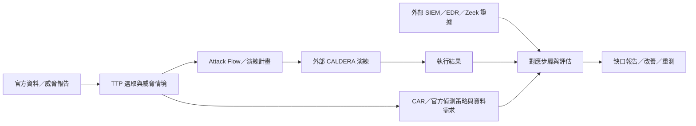

# MITRE 生態系整合評估與產品方向

查核日期：2026-10-19（Asia/Taipei）。本文是技術顧問的研究與建議，所有新增能力均為待實作提案。既有 21 個官方 Repo 的逐項證據見 [MITRE_REPOSITORY_INVENTORY.md](MITRE_REPOSITORY_INVENTORY.md)，架構提案見 [ARCHITECTURE.md](ARCHITECTURE.md)。

## 1. 結論

本案適合從 **TTP Selection Studio** 演進為 **以 ATT&CK 為核心的威脅分析與防禦驗證工作台**。建議先完成「技術 → 偵測內容 → 所需遙測 → 環境缺口」，再擴充攻擊流程、團隊知識管理，最後才接外部演練執行與告警證據。

這個定位是本評估的產品建議，並非 MITRE 對本案的背書。各階段的完成條件不同：只有分析與圖形時是研究／規劃工具；加入實際執行紀錄及防禦證據，才具備演練驗證能力。

## 2. 查核範圍與目前狀態

### 官方與相關組織的界線

2026-10-19 使用 GitHub connector 搜尋 `org:mitre-attack is:public fork:true`，每頁 100 筆，第 1 頁返回 21 個、第 2 頁為 0 個；metadata 中 13 個未封存、8 個已封存。[官方公開清單](https://github.com/orgs/mitre-attack/repositories?type=all)可人工交叉核對。搜尋可能有索引延遲，本次未將結果宣稱為組織 REST API 的即時完整列舉。

Attack Flow、CTID TRAM、Mappings Explorer、Adversary Emulation Library 屬於 `center-for-threat-informed-defense`；CALDERA 現行倉庫為 `apache/caldera`，舊 `mitre/caldera` 轉址至此。它們是相關生態系候選，沒有算進前述 21 個。[Attack Flow](https://github.com/center-for-threat-informed-defense/attack-flow)、[CALDERA](https://github.com/apache/caldera)。

### 本案已具備的能力

| 能力 | 本機靜態證據 | 對本次整合的意義 |
|---|---|---|
| 官方資料版本、三個領域、快照驗證與本機快取 | `attack_versions.py`、`attack_catalog.py` | 已有資料底座，不必重新建造下載器 |
| 原生矩陣、選取、註記、分數、公式、SVG／Excel | `attack_matrix.py`、`layer_analysis.py`、`matrix_exports.py`、`workbook_exports.py` | 可以投影新的偵測／演練結果 |
| Navigator Layer 交換與官方 SDK | `navigator_integration.py` 呼叫 `mitreattack.navlayers.core.Layer`、`DiffStix` | Navigator／SDK 已有部分整合，應增量補強 |
| 自訂 ATT&CK-compatible Bundle／Collection Index | `custom_sources.py` | 是新增資料來源的基礎，但不是通用 STIX 編輯器 |
| 獨立文件、保存與復原 | `studio_files.py`、`studio_workspace.py` | 可承載研究文件，新增情境／執行模型仍需設計 |
| 官方 Detection Strategies／Analytics／Data Components 瀏覽 | `attack_catalog.py` 的 `BROWSE_CATEGORIES` | CAR 應補上獨立偵測內容來源，不取代現有官方物件 |

依本次讀取的程式，尚未建立 CAR 匯入器、Attack Flow 圖形文件、Workbench 遠端同步、CALDERA 執行 connector 或 SIEM／EDR 告警對應。這是靜態盤點；本次未重新啟動 GUI 或執行既有 audits。

直接依賴宣告為 `mitreattack-python==6.2.1`。SDK 的 `MitreAttackData` README 明列使用 STIX 2.0；本案的 STIX 2.1 與已使用的 navlayers／DiffStix 應按模組驗證，不能推定整個 SDK 無條件支援所有 STIX 2.1 物件。[SDK README](https://github.com/mitre-attack/mitreattack-python/blob/main/README.md)。

### 版本現況

官方更新頁顯示 2026-10-13 發布 ATT&CK v20；官方 STIX collection index 的 Enterprise、Mobile、ICS 首筆皆為 20.0。[官方更新頁](https://attack.mitre.org/resources/updates/)、[官方 index](https://github.com/mitre-attack/attack-stix-data/blob/master/index.json)。

本機 `data/attack/active.json` 與 `latest.json` 目前都指向 v19.2，本次沒有下載 v20 或變更指標。因此「官方資料已發布」「本機已下載」「本案已驗證相容」必須分開記錄。Flow README 仍標示 ATT&CK v19.1、TRAM 標示 v13、Mappings Explorer 標示 v8–14；這些標示本身既不是完整資料清單，也不能當成 v20 相容證明。

## 3. 最值得整合的候選

以下優先序與整合方式均為本案建議；上游功能由各項官方連結支持。成本是相對工程判斷，不是已估算工期。

| 專案／來源 | 本案目前狀態 | 建議整合方式 | 新增價值與主要限制 | 優先度／相對成本 |
|---|---|---|---|---|
| [attack-stix-data](https://github.com/mitre-attack/attack-stix-data) | 已有核心整合 | 延續固定版本、commit／hash、唯讀原始快照 | 支援新資料及歷史研究；每次升版仍須驗證顯示、關聯與遷移 | 維持底座／低至中 |
| [mitreattack-python](https://github.com/mitre-attack/mitreattack-python) | 已用 navlayers、DiffStix | 經既有介面增量使用查詢／差異／格式工具 | 減少重複程式；逐模組確認 STIX 與欄位往返相容 | 維持底座／中 |
| [attack-navigator](https://github.com/mitre-attack/attack-navigator) | 已有 Layer 互通與原生呈現 | 優先完善格式互通與官方樣本驗證 | 交換威脅／防禦／演練圖層；嵌入完整網頁 UI 的增量價值較小 | 維持底座／中 |
| [CAR](https://github.com/mitre-attack/car) | 尚未整合 CAR 來源 | 讀取 analytics YAML，建立獨立偵測目錄並對應技術 | 顯示 hypothesis、資料需求、偽碼、部分工具 query 與測試參考；仍須在本地部署與驗證 | 第一批／中 |
| [Attack Flow（CTID）](https://github.com/center-for-threat-informed-defense/attack-flow) | 尚未整合 | 先做 Flow JSON 匯入／匯出及圖形視圖，保留節點／引用 | 表達順序、條件、AND／OR、資產與流程；Flow 不是可直接執行的 playbook | 第二批／中高 |
| [Workbench REST API](https://github.com/mitre-attack/attack-workbench-rest-api)、[Frontend](https://github.com/mitre-attack/attack-workbench-frontend)、[Deployment](https://github.com/mitre-attack/attack-workbench-deployment) | 尚未遠端整合 | 獨立部署；桌面以 connector 拉取 collections，之後加入差異預覽與發布 | 建立與分享組織自訂 ATT&CK 物件／關聯；Node.js、MongoDB、權限與衝突處理是額外工作 | 有團隊需求時／高 |
| [Workbench TAXII Server](https://github.com/mitre-attack/attack-workbench-taxii-server) | 僅有本地 envelope 複製，未連線 | 在 Workbench 基礎上做 TAXII 2.1 拉取／分享互通 | 與其他支援 TAXII 的系統交換 collections；此 server 依賴 Workbench，並非獨立知識庫 | 隨協作需求／中高 |
| [attack-data-model（ADM）](https://github.com/mitre-attack/attack-data-model) | 尚未使用 | 先用官方 schema 作驗證依據；必要時可選 Node 程序 | 更嚴謹驗證 STIX 2.1；它是 TypeScript，README 相容表有舊資訊，不能直接替換 Python 核心 | 支援工作／中 |
| [BZAR](https://github.com/mitre-attack/bzar) | 尚未整合 | 匯入規則描述與外部 Zeek notice；Zeek 獨立運作 | 補 SMB／DCE-RPC 等網路行為觀測；須有對應流量及 Zeek 相容驗證 | 有 Zeek 時／中高 |
| [CALDERA](https://github.com/apache/caldera)、[Emu](https://github.com/mitre/emu) | 尚未整合 | 外部伺服器；先讀 abilities／profiles／reports，後續才加入執行 | 提供演練與步驟結果；仍要另接遙測／告警證據才能判斷防禦效果 | 後期驗證／高 |
| [TRAM（CTID）](https://github.com/center-for-threat-informed-defense/tram) | 尚未整合 | 可選服務，將結果當待審核候選 | 報告文字輔助映射 TTP；README 明列開箱至多 50 個常見技術，中文與 v20 涵蓋率待測 | 獨立試點／中高 |
| [Mappings Explorer（CTID）](https://github.com/center-for-threat-informed-defense/mappings-explorer) | 尚未整合 | 按特定 mapping dataset 匯入，保留框架與 ATT&CK 版本 | 把安全控制／能力連至攻擊行為，輔助改善計畫；映射不代表控制已落實或有效 | 按需／中 |

Workbench 四個 Repo 是一個服務組合，並非四套桌面畫面。CALDERA README 指核心伺服器環境為 Linux／macOS；本案是 Windows 桌面，建議分離部署。[CALDERA requirements](https://github.com/apache/caldera#requirements)。

Attack Flow 的軟體版號與 Flow schema 版號要分開：目前語言文件標示 v4.0，而 repo 仍提供 `attack-flow-schema-2.0.0.json`。匯入能力應鎖具體 schema，不以名稱猜測相容。[語言文件](https://center-for-threat-informed-defense.github.io/attack-flow/language/)、[schema](https://github.com/center-for-threat-informed-defense/attack-flow/blob/main/stix/attack-flow-schema-2.0.0.json)。ADM README 亦將 TAXII 列為 coming soon，本案不能依 README 開頭的概括文字宣稱已具備 TAXII 支援。[ADM README](https://github.com/mitre-attack/attack-data-model/blob/main/README.md)。

## 4. 官方 21 個 Repo 的處置總覽

此表確保所有盤點項目有去向，不把歷史工具都變成執行依賴。狀態依本次 GitHub 搜尋 metadata；具體用途的逐 Repo 舊快照見既有 [盤點](MITRE_REPOSITORY_INVENTORY.md)，不是本次重跑所有相容性檢查。

| 分類 | Repo | 建議 |
|---|---|---|
| 已有整合基礎（3） | attack-stix-data、mitreattack-python、attack-navigator | 持續維護與補齊，避免重新實作 |
| 資料規格（1） | attack-data-model | 驗證與相容測試支援 |
| 協作服務（4） | attack-workbench-frontend、attack-workbench-rest-api、attack-workbench-taxii-server、attack-workbench-deployment | 視為同一服務組合，按需求啟用 |
| 偵測內容（2） | car、bzar | CAR 優先；BZAR 視網路遙測條件決定 |
| 參考／按需（3） | attack-website、caret、attack-arsenal | 網站作內容入口；CARET 作關聯視覺參考；Arsenal 作歷史演練資源，先審查再取用 |
| 已封存（8） | attack-scripts、attack-datasources、attack-datasources-stix-beta、tram、joystick、attack-evals、evals_caldera、attack-archives | 歷史兼容／研究參考；需相關能力時評估後繼來源 |

不建議以舊 attack-evals／joystick 建立現行產品效能排名，也不把 beta mock data 混進正式知識庫；歷史用途、版本及來源限制見 [既有官方證據盤點](MITRE_REPOSITORY_INVENTORY.md)。

## 5. 整合後會成為什麼產品

| 完成階段 | 產品型態 | 能回答的問題 | 還需要的本案工程 |
|---|---|---|---|
| 現況 | ATT&CK 研究與 TTP 文件工具 | 這個組織／平台涉及哪些技術？如何標註、比較、交換？ | 維護既有功能 |
| 偵測規劃 | 威脅導向的偵測規劃工作台 | 哪些技術有參考偵測？需要什麼資料？本環境缺什麼？ | CAR 解析、環境資料盤點、規則部署與證據狀態 |
| 情境規劃 | 攻擊情境與演練設計工作台 | 這些技術如何連成流程？在哪些步驟應該觀測或阻斷？ | Flow 文件／圖形、技術引用、情境與規則連結 |
| 團隊協作 | 組織威脅知識與規劃平台 | 團隊如何共用自訂技術、關聯及研究資料？ | Workbench connector、差異與衝突處理、來源／版本追溯 |
| 實測驗證 | Purple Team／防禦驗證工作台 | 演練是否執行成功？資料有沒有收集？規則是否產生告警？調整後是否改善？ | CALDERA adapter、run／step 模型、SIEM／EDR 證據輸入與關聯、重測比較 |

整合 Repo 只是取得可用的資料、格式或服務；上表右欄是我們仍要開發的產品能力。沒有企業的資產、遙測與實際測試結果，就只能作知識層面的缺口分析。

這是目標資料流，不是目前已完成的執行流程。Workbench 提供可共享的知識來源；TRAM 可輔助左端的候選映射。

## 6. 可藉由整合完成的具體工作

1. **建立威脅專屬評估範圍。** 從已有的 Group／Software／Campaign 技術關聯挑出情境，再結合企業實際平台與資產盤點縮小範圍；資產資料需另外提供。
2. **產生偵測工程待辦。** 從選取技術查到 CAR 與官方偵測策略，列出資料需求、參考 query、部署狀態及缺少的遙測，形成可追溯的工作清單。
3. **重建事件或演練流程。** 用 Flow 記錄先後、條件與分支，每個動作可連結技術、偵測及證據；順序由情境資料決定，不能從戰術欄位自動推定。
4. **比較預期與實測結果。** 透過外部演練結果及告警輸入，比對已執行的步驟、資料到達、告警、阻擋與延遲；CALDERA 的 success 本身不是藍隊偵測成功。
5. **追蹤改善與重測。** 調整規則或補資料後，在相同情境／版本下重測，輸出可追溯的變化圖層、表格與證據附件；現有 SVG／Excel 輸出是基礎。
6. **維持團隊知識與外部交換。** Workbench 管理自訂知識；Navigator／STIX／TAXII 按各自格式交換資料，保持本地研究文件與共享知識版本分離。

### 一個具體例子：PowerShell

官方 [CAR-2014-04-003](https://car.mitre.org/analytics/CAR-2014-04-003/) 已提供 PowerShell 執行偵測的資料欄位參考與 Splunk／EQL 等實作。整合後可規劃以下操作：

1. 使用者選取 T1059.001，查看本次 ATT&CK 版本的技術與偵測策略。
2. 顯示關聯 CAR analytic、所需 process 欄位、來源版本與工具限制；保留 CAR 原始對映，另列轉換至本版本的審閱結果。
3. 依企業提供的遙測盤點，檢查是否收集對應事件／欄位，產生缺口待辦。
4. 日後有演練與告警 connector 時，把特定 run／step、端點、時間窗及規則告警對應起來。
5. 依證據標示「有參考內容」「已部署」「本次實測產生告警」等不同狀態，並保留調整後的重測差異。

這個例子說明的是我們可以建出的工作流程，不表示匯入 CAR 後規則就會自動部署，也不表示該規則能偵測所有 PowerShell 攻擊變體。

## 7. 建議實作順序與驗收

| 階段 | 建議交付 | 可驗收的結果 |
|---|---|---|
| 0：固定來源與契約 | 版本／來源身分、獨立匯入及背景工作邊界；v20 相容檢查 | 能分辨資料版本、保留現有文件、不靜默改用 latest；不必先完成全案重構 |
| 1：CAR 與偵測規劃 | CAR 內容目錄、TTP 關聯、欄位需求、部署／證據狀態與缺口匯出 | 選一個技術可回溯原始 analytic；無對應時明確顯示；有規則但缺資料不會被計為已驗證 |
| 2：Attack Flow | Flow 匯入／匯出、流程圖、節點連結既有技術與偵測 | 往返保留順序、分支及引用；不支援欄位有明確提示；Flow 不自動轉成可執行命令 |
| 3：Workbench（按團隊需要） | 唯讀拉取 → 差異預覽 → 編輯與發布 | 固定 collection／version、權限與衝突可處理；離線核心仍可使用 |
| 4：外部演練與證據 | 先讀 profiles／結果，再做計畫映射、受控執行、告警輸入與重測 | 每個結果可追到 run／step、目標、版本與證據，清楚分開執行／觀測／偵測／阻擋 |

TRAM、Mappings Explorer、BZAR 是按資料與環境需求增補的支線；沒有需求時不應成為桌面啟動必要依賴。若只選下一個功能里程碑，本評估建議 **CAR＋偵測缺口規劃**，原因是能直接接上現有技術選取、偵測物件、圖層與匯出。

## 8. 整合時必須保留的技術界線

- **來源身分：** 每筆資料保留來源、版本／commit、hash、物件 ID／modified、ATT&CK domain；舊 ID、撤銷、替代與無法對應項目要可審閱。
- **資料模型：** Technique、CAR analytic、Flow action、CALDERA ability／step、告警是不同物件；一個技術可能對應多個實作，平台、executor、權限、facts 與依賴需分別驗證。
- **證據狀態：** 參考內容、規則已部署、資料已到達、特定情境已測試、產生告警、阻擋成功各自記錄；未知／未測試不能當成失敗或成功。
- **指標範圍：** 若計算覆蓋或延遲，必須固定評估技術集合、平台、時間窗、情境及資料來源；不能把矩陣分數或上色稱為整體安全分數。
- **執行環境：** PySide6 核心保留；Workbench、Zeek、CALDERA、ML 服務各自部署，connector 不可用時應明示原因。資料匯入不觸發上游測試命令或演練。
- **授權紀錄：** 上游程式、ATT&CK 資料及第三方內容的授權來源要逐項保存；既有盤點可作起點，實際打包版本再核對其 LICENSE／NOTICE。
- **使用者既有規範：** 實作任何新程式時，運作前顯示輸入／輸出絕對位址，各階段呈現進度並處理完成／取消／失敗，且在程式同目錄 README 記錄流程。

## 9. 本次研究的輸入、輸出與驗證範圍

- 本機輸入：`D:\MITREATTACK_SIMULATOR\README.md`、`ARCHITECTURE.md`、`MITRE_REPOSITORY_INVENTORY.md`、`NOTIMPLEMENTYET.md`、`requirements.txt`、本表列出的 Python 程式，以及 `data\attack\active.json`／`latest.json`。
- 外部輸入：官方組織清單、GitHub 搜尋 metadata、上述 Repo README／schema、ATT&CK 更新頁與 CAR／Attack Flow 官方文件。
- 輸出：`D:\MITREATTACK_SIMULATOR\MITRE_INTEGRATION_ASSESSMENT.md`；`D:\MITREATTACK_SIMULATOR\README.md` 增加導覽連結。
- 流程：讀取本案現況 → 官方來源查核 → 區分既有／提案能力 → 評估產品用途與整合階段 → 文件與連結校對。
- 未執行：套件升級、上游安裝／執行、資料升版、API 相容實測、GUI／程式測試或演練。本次文件不得當成任何新 connector 已完成的證據。
