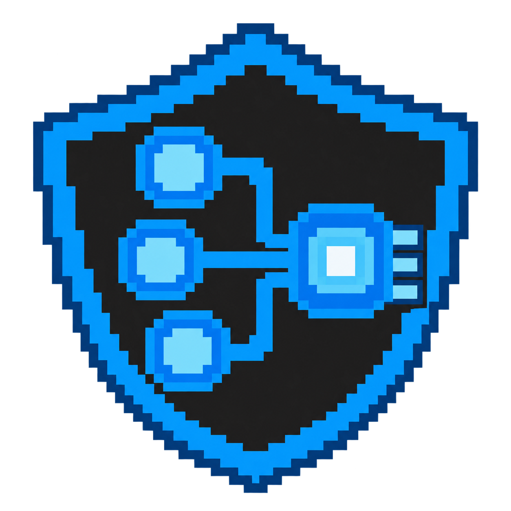

# Fusion Studio Icon

## 目前使用：黑白像素 v3（ATT&CK／ATLAS／CAR）

此版為使用者確認套用的最後預覽：左側三個簡潔節點連向右側較大的橫向長方形，框內保留偵測波形；黑白像素風格，無盾牌、無針腳，外部背景透明。三個元素分別表達技術關聯、AI 研究與偵測分析，是專案自己的視覺比喻。

- 已確認預覽來源：`C:\Users\nick5\.codex\generated_images\01a12ebb-9961-7a90-a586-51dd4683493c\exec-afa6b689-a1b8-496d-a0d4-b84d1f521229.png`
- 專案 PNG：`D:\MITREATTACK_SIMULATOR\assets\fusion-studio-icon-monochrome-v3.png`（1254 × 1254，RGBA，394,208 bytes）
- Windows ICO：`D:\MITREATTACK_SIMULATOR\assets\fusion-studio-icon-monochrome-v3.ico`（16／32／48／64／128／256 像素）
- 最後一輪生成提示詞：`D:\MITREATTACK_SIMULATOR\assets\fusion-studio-icon-monochrome-v3-prompt.txt`


流程：原設計透過內建 image_gen 逐步重繪，最後依要求放大右側並改成橫向長方形；此次套用不重新生成。先顯示來源與輸出絕對位址，再依 **1/3 檢查 → 2/3 複製 → 3/3 雜湊驗證** 將已確認預覽原封不動複製至版本化檔名。`scripts/build_windows_icon.py` 再依 **1/3 讀取 → 2/3 六尺寸編碼 → 3/3 發布** 產生透明 ICO。`main.py::configure_application` 載入 PNG，`MainWindow.configure_native_taskbar` 載入 ICO 並讀回 Windows 工作列屬性驗證；專案 README 開頭及 `scripts/make_demo_video.py` 使用同一 PNG。各程式保留絕對輸入／輸出位置及階段進度；舊 v2 與 ATT&CK 導覽圖示保留。重新啟動程式套用；若 Windows 已釘選捷徑保留舊快取，可取消釘選後重新釘選。

套用驗證（2026-10-23）：PNG 與已確認預覽的 SHA-256 完全一致，透明 Alpha 保留；六個 ICO 內嵌 PNG 的尺寸、Alpha 及 Windows 原生 `LoadImageW` 載入均通過。以隔離設定、停用 recovery 的隱藏 Windows Qt 主視窗，逐像素確認應用程式／主視窗／對話框的 64px 圖示來自 v3 且不同於 v2；工作列屬性讀回為 v3 ICO 與既有 AppUserModelID，README 開頭亦使用 v3。未啟動資料載入或改動使用者文件。差異空白檢查通過。

## Nicoa HackMD 黑白像素封面

**1 MB 以內版本**：`D:\MITREATTACK_SIMULATOR\assets\nicoa-hackmd-cover-under-1mb.png`，實際 **604,557 bytes（604.6 KB）**，低於 1,000,000 bytes。維持原圖 **1672 × 941** 尺寸。壓縮流程先顯示原圖與輸出圖的絕對路徑，再依 **1/3 讀取 → 2/3 PNG 最佳化 → 3/3 尺寸及大小驗證** 處理。原圖 1,862,926 bytes；RGB 最佳化仍超限，因此使用灰階 PNG 最佳化，保留黑白像素與抖色構圖、不縮放，並另存新檔。已重新開啟檔案驗證尺寸與大小。

此圖由黑白融合構圖延伸為 HackMD 文章使用的橫式封面。螢幕中的兩個人物、復古電腦及 `I DON'T CARE`／`1925` 塗鴉保留；網路地球與節點移除，改為實際書桌場景，旁邊新增正面標示 **Nicoa** 的直立式桌上型主機。桌面包含鍵盤與滑鼠，維持黑白像素、抖色網點及清楚的階梯輪廓，使用完整不透明背景。

- 輸入設計：`D:\MITREATTACK_SIMULATOR\assets\fusion-studio-monochrome-composite-v1.png`
- 封面 PNG：`D:\MITREATTACK_SIMULATOR\assets\nicoa-hackmd-cover-v1.png`
- 完整提示詞：`D:\MITREATTACK_SIMULATOR\assets\nicoa-hackmd-cover-v1-prompt.txt`

流程：**1/3 確認前版與修改要求 → 2/3 使用內建 image_gen 編輯為橫式書桌場景 → 3/3 儲存及驗證**。工具輸出以新版檔名複製至專案，複製前顯示絕對來源及輸出路徑，同名目標已存在時停止。已檢視人物、無網路地球、獨立主機、Nicoa 拼字與橫式構圖，再讀取檔案尺寸確認為橫向封面。原版設計保留。

## 黑白像素融合構圖

以使用者提供的五張參考圖融合製作：第一張的塗鴉文字與顆粒感、兩張照片中的人物表情及姿態、復古桌上型電腦，以及網路地球與節點。構圖以電腦螢幕容納兩個人物形象，右上連接網路地球，機殼融入 `I DON'T CARE` 與 `1925` 塗鴉。採黑白像素與抖色網點視覺，外部背景透明，提供為獨立融合設計圖。

- 圖檔：`D:\MITREATTACK_SIMULATOR\assets\fusion-studio-monochrome-composite-v1.png`
- 完整提示詞：`D:\MITREATTACK_SIMULATOR\assets\fusion-studio-monochrome-composite-v1-prompt.txt`
- 生成工具：內建 image_gen；五張圖片皆作為視覺參考，兩張人物照片另作為人物外觀與姿態參考。

製作流程與進度：**1/3 檢視五張參考圖 → 2/3 一次融合生成單一構圖 → 3/3 複製到專案並驗證尺寸及透明背景**。複製與驗證前先顯示來源及輸出圖片的絕對路徑；同名輸出已存在時停止以保留既有設計。檢視生成結果，確認人物、電腦、網路地球、連線節點與塗鴉元素均呈現，再讀取 PNG 尺寸及角落 Alpha 作檔案驗證。

## 歷史版本 Fusion Studio v2：ATT&CK 與 ATLAS 融合圖示

此新版以目前 Fusion Studio 的雙框架 Workplace 為設計依據，延續藍色點陣與透明背景。盾牌代表資安研究與防護；三個技術關聯節點連入中央 AI 晶片，表達 ATT&CK 與 ATLAS 在同一工作空間融合。亮色晶片核心提供小尺寸辨識重點。這些是專案自己的視覺比喻，並非 MITRE 官方標誌。

- PNG：`D:\MITREATTACK_SIMULATOR\assets\fusion-studio-icon-pixel-v2.png`
- Windows 多尺寸 ICO：`D:\MITREATTACK_SIMULATOR\assets\fusion-studio-icon-pixel-v2.ico`
- 完整生成提示詞：`D:\MITREATTACK_SIMULATOR\assets\fusion-studio-icon-v2-prompt.txt`
- 專案用途輸入：`D:\MITREATTACK_SIMULATOR\README.md`、`D:\MITREATTACK_SIMULATOR\app_identity.py`
- 風格參考輸入：`D:\MITREATTACK_SIMULATOR\assets\ttp-selection-studio-icon-pixel.png`



製作流程：**1/3 理解專案與設計 → 2/3 內建 image_gen 繪製 → 3/3 儲存、打包及驗證**。內建工具以舊圖作為風格參考，生成單一新版 PNG。將生成結果複製到上述版本化檔名，再使用 PySide6 的 QImage 將同一 PNG 以最近鄰方式縮放為 16、32、48、64、128、256 像素；各尺寸保留透明 PNG 資料，依 ICO 標頭與目錄格式打包。處理前列印絕對輸入及輸出路徑，每個尺寸編碼時顯示進度，最後驗證 PNG 尺寸、Alpha 及 ICO 目錄。讀取、編碼或寫入失敗會回報錯誤並以非零狀態結束。這次交付以新版 PNG 與 ICO 檔案提供。

應用程式顯示名稱為 **Fusion Studio**；此段記錄 v2 的歷史套用流程，目前主要圖示已改用上方黑白 v3。`app_identity.py` 提供工作列與視窗顯示名稱；`main.py::configure_application()` 載入目前 PNG，`MainWindow.configure_native_taskbar()` 使用目前 ICO 設定 Windows 工作列圖示，`scripts/build_windows_icon.py` 也以目前 PNG 為來源。各流程保留絕對輸入輸出路徑與分階段進度。完整品牌套用順序見根目錄 [README.md](../README.md#application-name-and-startup-flow)。

套用驗證：使用隔離設定檔與停用工作階段回復的隱藏原生 Qt 視窗，逐像素確認應用程式、主視窗及對話框的 64 像素圖示符合新版 PNG，且不同於舊版。Windows 視窗屬性讀回的 ICO 路徑、顯示名稱與 `FusionStudio.Desktop` 識別均正確；`LoadImageW` 成功載入 16、32、48、64、128、256 六種 ICO 尺寸。另確認 README 圖片使用新版、ATT&CK TTP 分類維持原圖。這些檢查均通過，沒有改動使用者的設定或文件。

左側 ATT&CK 導覽入口保留既有分類圖示，TTP 使用原始盾牌節點與勾選圖示；預覽、來源、完整提示詞與整合流程見 [navigation/README.md](navigation/README.md)。

## 點陣／像素風格版本

依使用者要求，使用內建 image_gen 工具將原始 Icon 重繪為像素風格，保留盾牌、三個 TTP 階層節點、白色勾選與藍／深灰配色。以階梯狀邊緣與方塊細節呈現像素感，PNG 保留透明背景。此版本為生成的像素風格圖像，提示詞中的 48 × 48 為視覺設計目標，並非交付檔案尺寸。

- 輸入原圖：`D:\MITREATTACK_SIMULATOR\assets\ttp-selection-studio-icon.png`
- 輸出新版：`D:\MITREATTACK_SIMULATOR\assets\ttp-selection-studio-icon-pixel.png`

製作流程：1/3 檢視原圖；2/3 使用原圖重繪像素風格；3/3 另存新版並檢查尺寸與透明背景。原始圖像保留。

### 應用程式圖示整合

`D:\MITREATTACK_SIMULATOR\main.py` 的 `configure_application()` 目前載入 `fusion-studio-icon-monochrome-v3.png`，透過 `QApplication.setWindowIcon()` 設定主視窗及對話框的預設圖示。啟動時先顯示圖片的絕對輸入路徑及無輸出檔案狀態，再顯示載入（1/2）與套用（2/2）進度。路徑依程式位置解析，不受目前工作目錄影響；讀取失敗時顯示訊息並使用系統預設圖示。重新啟動應用程式即可生效。

Windows 工作列使用 `D:\MITREATTACK_SIMULATOR\assets\fusion-studio-icon-monochrome-v3.ico`，包含 16、32、48、64、128、256 像素透明圖像，由 `scripts/build_windows_icon.py` 將既有 PNG 包裝而成。`main.py` 先設定行程 AppUserModelID，再由 `windows_taskbar.py` 將視窗 AppUserModelID、ICO 圖示資源、應用程式名稱與完整重新啟動命令寫入 Windows 視窗屬性並讀回驗證。這補足 Microsoft Store Python 僅設定行程識別或 Qt 視窗 Icon 時仍沿用 Python 工作列圖示的情況。啟動時顯示絕對 ICO 輸入路徑、無輸出檔案狀態及三階段進度；失敗時顯示訊息並繼續。完整流程及驗證結果見根目錄 README。既有釘選捷徑若仍顯示 Python 圖示，可取消釘選後重新釘選執行中的程式。

### 像素版本完整提示詞

```text
Use case: style-transfer.
Asset type: one pixel-art desktop application icon for Fusion Studio.
Edit target: the referenced existing shield, three-node hierarchy, and checkmark icon.
Primary request: redraw this same icon as authentic low-resolution pixel art. Preserve the identity, blue/charcoal palette, shield silhouette, three connected hierarchy nodes, and prominent white selection checkmark in the lower-right. Convert every curved edge to carefully designed staircase pixel contours.
Style/medium: expertly hand-crafted 48-by-48 logical pixel sprite, displayed enlarged with uniform square pixels and nearest-neighbor appearance. Flat limited palette, at most 8 colors, crisp hard edges, chunky pixel clusters, a few deliberate stepped highlights only. The whole composition must look like an actual retro desktop/game inventory sprite, not a smooth drawing with a pixel texture.
Composition/framing: one centered large icon on a square transparent canvas, consistent outer transparent padding. Make the hierarchy nodes square pixel clusters with light-blue centers; horizontal/vertical connections. The checkmark must have thick pixel-stepped diagonal strokes and remain highly legible.
Colors: dark charcoal opaque shield interior, dark blue stepped outline, bright #007acc blue shield frame, lighter #4daafc blue details, near-white checkmark.
Constraints: actual transparency outside shield and checkmark. Preserve opacity inside shield. No smooth curves, no antialiasing, no blur, no gradients, no 3D rendering, no glow, no shadows outside silhouette, no visible background grid, no text or lettering, no mockup, no extra icons, no watermark. Show just the final pixel-art icon.
```

## 設計概念

此 Icon 依據專案的資安研究、ATT&CK 技術階層與 TTP 選取流程設計。盾牌表示資安研究，三個連接節點表示技術階層，白色勾選表示將技術納入文件。藍色與深灰沿用目前桌面介面的配色。圖片不包含文字，外部背景透明。

## 輸入與輸出

- 專案說明：`D:\MITREATTACK_SIMULATOR\README.md`
- 介面配色來源：`D:\MITREATTACK_SIMULATOR\main.py`
- 最終 PNG：`D:\MITREATTACK_SIMULATOR\assets\ttp-selection-studio-icon.png`
- 本說明：`D:\MITREATTACK_SIMULATOR\assets\README.md`

## 製作流程與進度

1. 讀取專案 README 與介面配色，確認產品用途。
2. 使用內建 image_gen 工具繪製一個透明背景 Icon。
3. 檢視生成圖，保留原始檔並複製到本目錄，確認圖片尺寸、像素格式及左上角透明度。

原始 PNG 為 1254 × 1254，格式為 32 位元 ARGB，已確認左上角完全透明。應用程式目前使用本文件開頭的 Fusion Studio v2 融合圖示；此原始平滑版本保留作為設計來源。

## 完整生成提示詞

```text
Use case: logo-brand.
Asset type: a single polished desktop application icon for Fusion Studio, a cybersecurity research application that browses MITRE ATT&CK tactics/techniques, selects techniques in a hierarchy, and exports selected TTP documents.
Primary request: create an original memorable app icon combining a protective shield silhouette with a minimal branching technique-node structure and an integrated selection checkmark.
Style/medium: precise vector-like geometric raster artwork, professional contemporary desktop software identity, bold clean shapes, restrained subtle dimensional depth.
Composition/framing: square canvas, one centered cohesive icon, large recognizable silhouette occupying about 80 percent of canvas, generous consistent transparent outer margin. Inside the shield, just three substantial connected technique nodes; integrate a clear bright checkmark into the lower-right of the shield, making selection the dominant secondary motif. Keep forms thick and distinguishable at 32px; restrained detail.
Color palette: dark charcoal #1e1e1e shield interior, strong blue #007acc shield frame and structure, lighter blue #4daafc node accents, white checkmark. Palette drawn from the project's existing dark VS Code-inspired desktop UI.
Scene/backdrop: genuinely transparent background outside the icon. The shield itself remains opaque.
Constraints: deliver one standalone app icon only, no text, no letters, no caption, no mockup, no presentation board, no extra alternatives, no watermark, no official MITRE logo, no padlock, no hacker imagery, no tiny circuit lines, no excessive glow, no cast shadow outside the icon. Crisp antialiased edges, visual simplicity and strong legibility.
```
